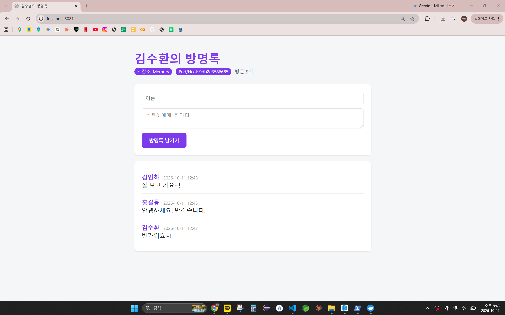
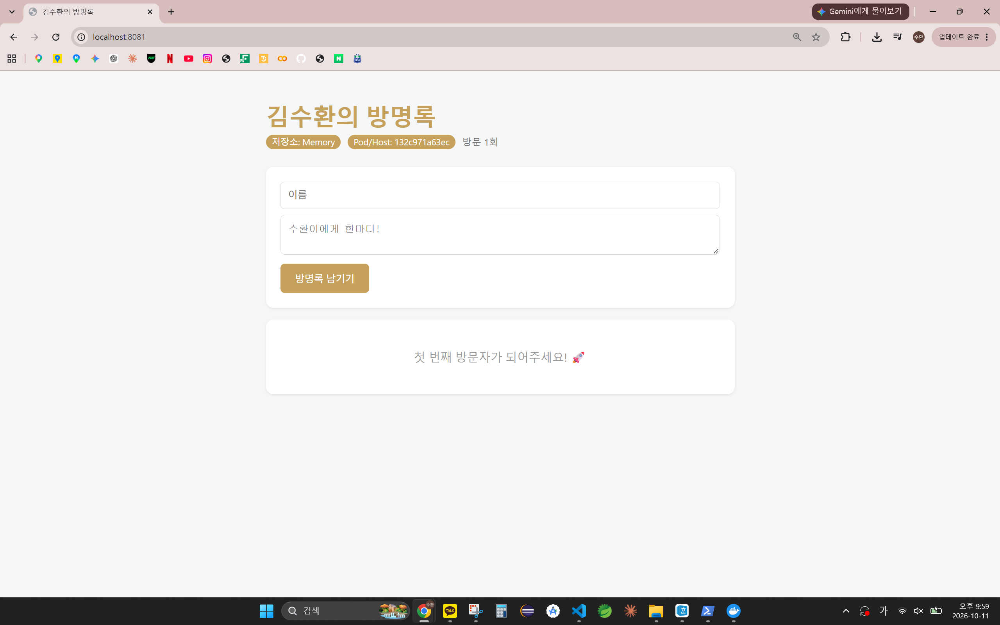

# 6주차 - Dockerfile로 나만의 방명록 이미지 만들기

교수님이 준 방명록 앱(`guestbook/`)을 Dockerfile로 이미지화하고, 제목·테마·문구를 바꾼 `guestbook:v2`를 ghcr.io에 푸시했다.
흐름: `guestbook/` → build → `guestbook:v2` → tag·push → `ghcr.io/kimsuhwan1019/guestbook:v2` → pull·run (`-e`로 설정만 변경)

## 오늘 배운 내용
- Dockerfile 주요 명령어: `FROM` `WORKDIR` `COPY` `RUN` `ENV` `EXPOSE` `CMD`
- `RUN`은 이미지 만들 때, `CMD`는 컨테이너 켤 때, `EXPOSE`는 포트 문서화일 뿐
- 레이어 캐시: 한 단계가 바뀌면 그 아래는 전부 다시 빌드 → 자주 바뀌는 것은 뒤로
- 설정 우선순위: app.py 기본값 < Dockerfile `ENV` < `docker run -e`
- 이미지 주소 `레지스트리/계정/이미지:태그`(생략 시 `latest`), 배포 흐름 build → tag → push → pull → run
- 상세는 맨 아래 개념 정리에

## 새로 배운 명령어
```bash
# --- 빌드 ---
docker build -t guestbook:v2 .                         # 현재 폴더를 빌드 컨텍스트로 이미지 생성
# --- 레지스트리 ---
gh auth token | docker login ghcr.io -u kimsuhwan1019 --password-stdin  # gh 토큰으로 ghcr.io 로그인
gh auth refresh -h github.com -s write:packages,read:packages           # 토큰에 패키지 권한 추가
docker tag guestbook:v2 ghcr.io/kimsuhwan1019/guestbook:v2   # 레지스트리 주소로 이름 붙이기
docker push ghcr.io/kimsuhwan1019/guestbook:v2         # 업로드
docker pull ghcr.io/kimsuhwan1019/guestbook:v2         # 다운로드
# --- 설정 주입 / 기록 ---
docker run -d -p 8081:5000 -e THEME_COLOR="#C6A15B" --name gbv2 ghcr.io/kimsuhwan1019/guestbook:v2  # ENV 덮어쓰기
git tag week06 && git push origin week06               # 6주차 시점 표시
```

## 실행 방법
```bash
docker run -d -p 8081:5000 --name gbv2 ghcr.io/kimsuhwan1019/guestbook:v2   # 실행 후 브라우저 http://localhost:8081
docker rm -f gbv2                                      # 종료 및 정리
```

## 파일 구성
```
devops/
├── guestbook/                # 방명록 앱 (주차별 복사 없이 계속 업데이트, 변화는 Git 태그로 기록)
│   ├── Dockerfile            # 줄별 주석 + ENV 제목·테마 수정
│   └── templates/index.html  # 문구 3곳 수정 (입력창 안내, 버튼, 빈 목록 안내)
└── week06/                   # README.md + images/ (실습 캡처)
```

## 실행 결과
- 이미지 주소: `ghcr.io/kimsuhwan1019/guestbook:v2` (Public). push digest `sha256:8f7d0683...` = 로컬 이미지 ID, rmi 후 pull해도 같은 digest
- 첫 빌드 11.5s → 문구 한 줄 수정 후 재빌드 3.0s (`[2/6]`~`[4/6]` CACHED, pip install 5.5s → 0.0s)
- `-e THEME_COLOR="#C6A15B"` → 구운 보라색 대신 금색, 글 목록은 비어 있음 (이미지는 데이터를 공유하지 않음)

| 내 방명록 (v2) | pull 후 -e로 색만 변경 |
|---|---|
|  |  |

## 막혔던 부분
- `docker` 명령을 못 찾음 → Docker Desktop WSL integration은 켜져 있었음. `wsl --shutdown` 후 재접속으로 해결
- push에서 `permission_denied: ... expected scopes` → `gh auth refresh`로 `write:packages` 추가(브라우저가 안 열려 github.com/login/device에 코드 직접 입력) → `docker logout ghcr.io` 후 재로그인해야 반영됨
- ghcr.io 경로는 소문자만 → `Kimsuhwan1019`가 아니라 `kimsuhwan1019`
- 방명록 글 시간이 9시간 늦게 찍힘 → 컨테이너 기본 시간대가 UTC (교안 외)

---

<details>
<summary><b>개념 정리</b> (클릭해서 펼치기)</summary>

### Dockerfile 각 줄이 하는 일
| 줄 | 하는 일 |
|---|---|
| `FROM python:3.12-slim` | 기반 이미지. 파이썬이 설치된 경량 리눅스에서 시작 |
| `WORKDIR /app` | 이후 명령의 작업 디렉터리. 없으면 만들어 줌 (cd와 비슷) |
| `COPY requirements.txt .` | 의존성 목록만 먼저 복사 → 코드가 바뀌어도 다음 줄 캐시 유지 |
| `RUN pip install --no-cache-dir -r requirements.txt` | 빌드할 때 한 번 실행, 설치 결과가 레이어로 남음 |
| `COPY . .` | 나머지 소스 복사. 자주 바뀌므로 뒤에 둠 (`.dockerignore` 대상 제외) |
| `RUN useradd -m appuser` / `USER appuser` | root가 아닌 일반 사용자로 실행 (보안) |
| `ENV APP_TITLE=... THEME_COLOR=...` | 환경 변수 기본값을 이미지에 굽기 |
| `EXPOSE 5000` | 사용할 포트 문서화. 실제로 여는 건 `-p 8081:5000` |
| `CMD ["python", "app.py"]` | 컨테이너 시작 시 실행. 마지막 CMD만 유효, 배열 형태 권장 |

### 레이어와 캐시
- RUN·COPY는 파일시스템 레이어, ENV·CMD·EXPOSE·USER는 메타데이터
- 명령어와 입력 파일이 같으면 이전 결과 재사용(CACHED). 한 단계가 무효화되면 이후 단계 전부 재실행
- 나쁜 순서: `COPY . .` → `RUN pip install` (코드 한 줄만 고쳐도 매번 재설치)
- 좋은 순서: `COPY requirements.txt .` → `RUN pip install` → `COPY . .`
- 빌드 컨텍스트 `.`: COPY 원본 경로의 기준. 빠뜨리면 에러

### 설정을 넣는 세 가지 방법
| 방법 | 언제 확정 | 바꾸려면 |
|---|---|---|
| app.py 기본값 | 코드 | 코드 수정 후 재빌드 |
| Dockerfile ENV | 이미지 빌드 시점 | 재빌드 |
| docker run -e | 컨테이너 실행 시점 | 컨테이너만 다시 실행 |
- 우선순위는 아래로 갈수록 높음. 이 앱은 app.py가 "DevOps 방명록 / 빨강"이지만 ENV가 덮어씀
- `-e`는 나중에 k8s ConfigMap으로 이어짐 (교안 예고)

### 이미지 주소와 공유
- `ghcr.io / kimsuhwan1019 / guestbook : v2` = 레지스트리 / 계정 / 이미지 / 태그. 레지스트리를 생략하면 도커 허브
- 태그를 생략하면 `latest`를 요청할 뿐, 최신 버전을 찾아주지 않음 → 없으면 `not found`
- ghcr.io 패키지는 기본 Private → Package settings → Change visibility → Public 해야 남이 pull 가능
- 받는 쪽은 소스 코드·Flask·파이썬 버전 없이 실행됨 → "내 컴퓨터에서는 되는데요?" 문제를 줄임

### 멀티 아키텍처 (참고)
- Apple Silicon(arm64)에서 빌드한 이미지는 x86-64(amd64) PC에서 느리거나 실패할 수 있음
- `docker buildx build --platform linux/amd64,linux/arm64 -t ghcr.io/아이디/guestbook:v1 --push .`

### 생각해보기
- 컨테이너를 재시작하면 색(ENV)은 그대로인데 글은 사라짐 → 글이 프로세스 메모리에 저장되기 때문
- 데이터를 남기려면 컨테이너 밖에 저장해야 함 → 다음 시간 Volume

</details>
