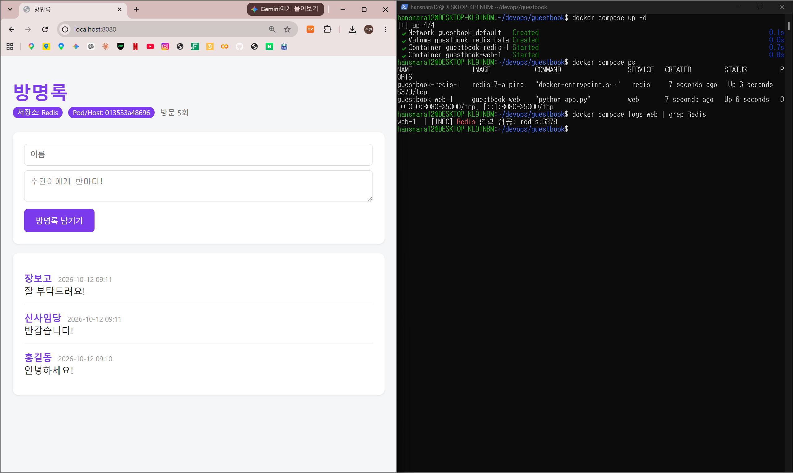
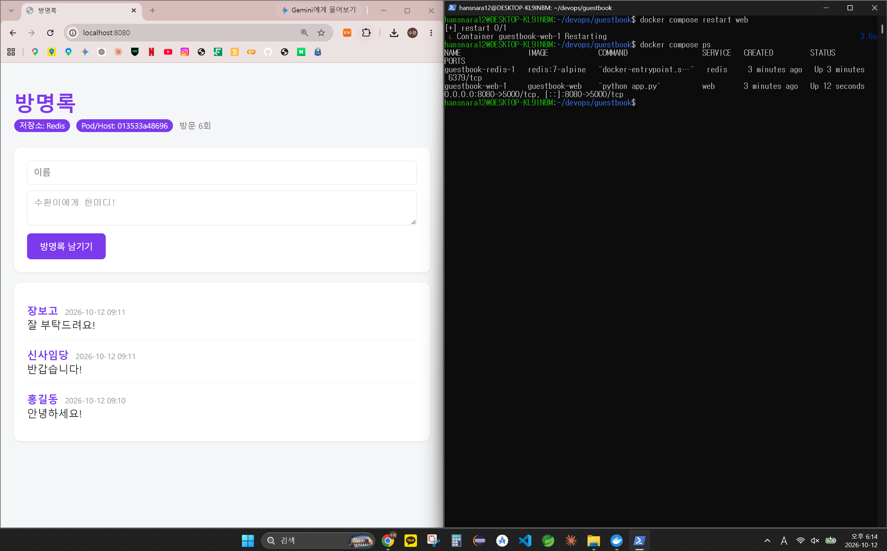
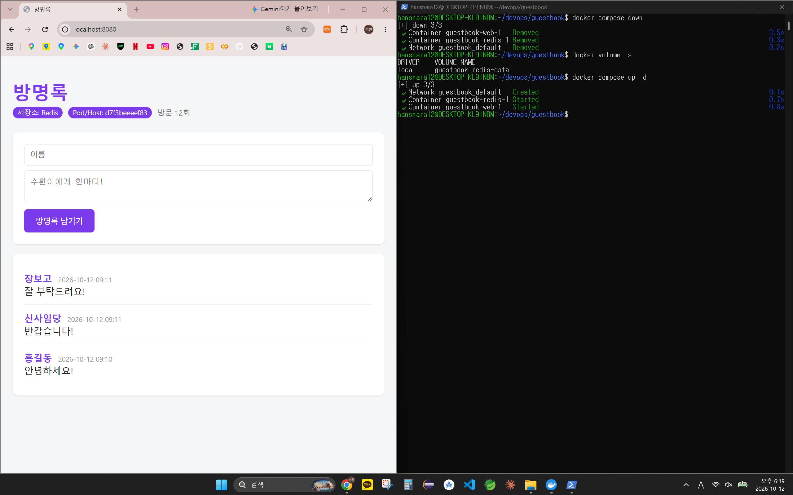
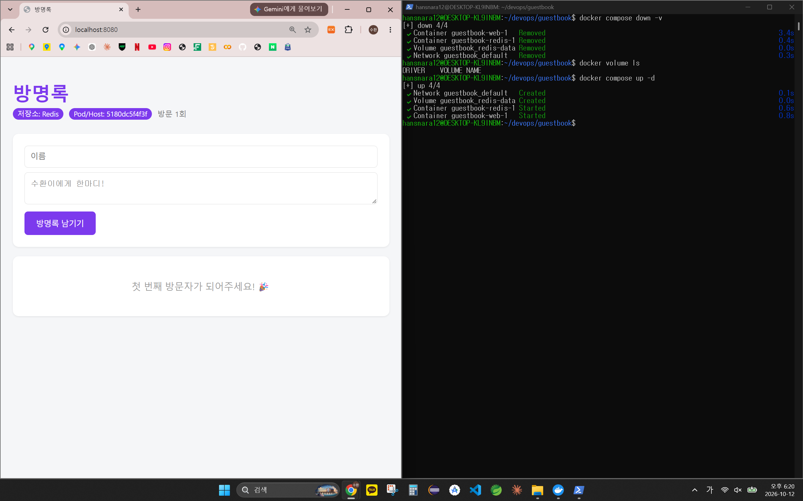
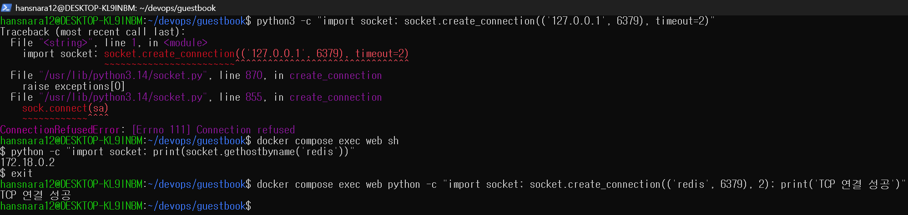
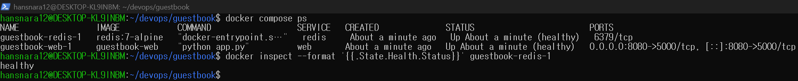
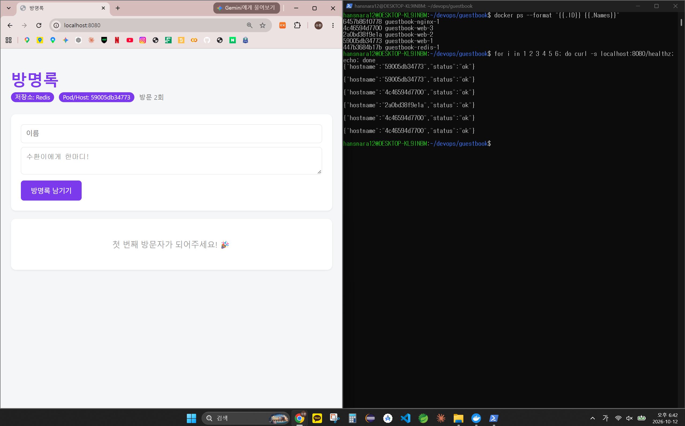
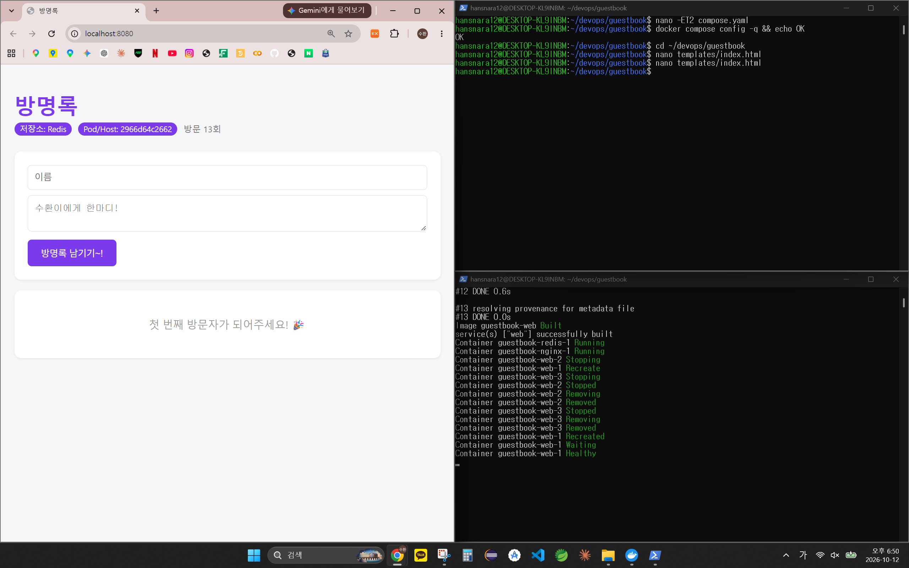

# 7주차 - Docker Compose로 방명록 + Redis + nginx 구성

6주차 방명록은 재시작하면 글이 사라졌다. 이번 주에는 앱(web)과 DB(redis)를 다른 컨테이너로 나누고,
`compose.yaml` 하나로 함께 띄워 글이 유지되게 했다. 이어서 비밀번호 분리(.env), healthcheck, nginx + scale까지 구성했다.

```
브라우저 :8080
      │
  [nginx]              ← 외부에 열린 유일한 문 (8080:80)
      │ 요청 분배
[web] [web] [web]      ← --scale web=3, 내부 5000만 사용 (expose)
      │
  [redis]              ← 비밀번호는 .env, 데이터는 볼륨 redis-data
```

## 오늘 배운 내용

- 컨테이너 하나 = 역할 하나: 앱과 DB를 나누면 앱만 재시작해도 데이터가 남는다
- `compose.yaml` 하나로 네트워크·볼륨·컨테이너를 한 번에 만들고 지운다
- 같은 네트워크에서는 서비스 이름이 곧 주소다 (`REDIS_HOST: "redis"`)
- 볼륨: `down`은 데이터를 남기고, `down -v`는 데이터까지 지운다
- `ports:`가 없는 서비스는 호스트에서 접근할 수 없다 (redis는 내부 전용)
- `.env`로 비밀번호를 Git 밖에 두고, healthcheck로 "시작"이 아니라 "준비 완료"를 기다린다
- nginx(리버스 프록시)를 앞에 두면 web을 여러 개로 늘려도 포트 하나로 받을 수 있다

상세는 맨 아래 개념 정리에

## 새로 배운 명령어

```bash
# --- compose 기본 ---
docker compose up -d                     # compose.yaml대로 네트워크·볼륨·컨테이너 생성 (백그라운드)
docker compose ps                        # 이 프로젝트의 컨테이너 상태 (healthy 포함)
docker compose logs web                  # web 서비스 로그
docker compose logs -f web               # 로그 따라가기 (Ctrl+C는 로그 보기만 종료)
docker compose restart web               # web만 재시작
docker compose exec web sh               # 실행 중인 web 컨테이너 안으로 들어가기
docker compose down                      # 컨테이너·네트워크 삭제 (볼륨은 유지)
docker compose down -v                   # 볼륨까지 삭제 (데이터 사라짐)

# --- 볼륨 ---
docker volume ls                         # 볼륨 목록
docker volume inspect guestbook_redis-data   # 볼륨이 저장된 위치(Mountpoint) 확인

# --- 검사 ---
nano -ET2 compose.yaml                   # Tab을 스페이스 2칸으로 바꿔서 입력
docker compose config -q                 # YAML 문법·구성 검사 (문제 없으면 출력 없음)
docker compose config | grep requirepass -A1   # .env 값이 채워진 최종 설정 확인 (-A1: 아래 1줄 더)
REDIS_PASSWORD= docker compose config --quiet  # 값이 비었을 때 에러가 나는지 확인
docker inspect --format '{{.State.Health.Status}}' guestbook-redis-1   # 헬스 상태만 출력

# --- scale / watch ---
docker compose up -d --scale web=3       # web 컨테이너를 3개로 늘리기
docker ps --format "{{.ID}} {{.Names}}"  # 컨테이너 ID와 이름만 출력
docker compose watch --no-up             # 실행 중인 컨테이너 감시, 파일 저장 시 자동 rebuild
```

## 실행 방법

```bash
cd ~/devops/guestbook
echo "REDIS_PASSWORD=원하는비밀번호" > .env   # .env는 저장소에 없으므로 직접 생성 (.env.example 참고)
docker compose up -d --scale web=3
docker compose ps                            # 5개 Up, web 3개와 redis는 (healthy)
# 브라우저에서 http://localhost:8080 (새로고침하면 Pod/Host가 바뀜)
docker compose down                          # 종료 (글은 볼륨에 남음, 완전히 지우려면 down -v)
```

## 파일 구성

```
devops/
├── .gitignore                 # .env 추가
├── guestbook/
│   ├── compose.yaml           # nginx + web + redis, healthcheck, watch 설정
│   ├── nginx.conf             # 받은 요청을 web:5000으로 전달 (리버스 프록시)
│   ├── .env.example           # .env 양식 (실제 .env는 Git에서 제외)
│   ├── templates/index.html   # 버튼 문구 수정 (watch 테스트)
│   └── app.py, Dockerfile 등  # 6주차 그대로
└── week07/
    ├── README.md
    └── images/                # 실행 결과 캡처 8장
```

## 실행 결과

### 1. 재시작·down·down -v 비교 (교안 22~27p)

| 단계 | 터미널 | Pod/Host | 글 | 방문 |
|---|---|---|---|---|
| `up -d` | `Redis 연결 성공: redis:6379` | 013533a48696 | 3개 | 5 |
| `restart web` | web만 `Up 12 seconds` | 013533a48696 (그대로) | 3개 | 6 |
| `down` → `up` | 볼륨 남음, `up 3/3` | d7f3beeeef83 (바뀜) | 3개 | 12 |
| `down -v` → `up` | Volume `Removed` → `Created`, `up 4/4` | 5180dc5f4f3f (바뀜) | **0개** | **1** |

- `restart`는 같은 컨테이너를 다시 켜서 ID가 그대로다. `down` 후 `up`은 컨테이너를 새로 만들어 ID가 바뀌지만, 볼륨이 남아 있어서 글과 방문 수가 이어진다.
- `down -v`는 볼륨까지 지워서 "첫 번째 방문자가 되어주세요!" 화면부터 다시 시작한다.






### 2. 네트워크 격리 (교안 29~30p)

```
$ python3 -c "import socket; socket.create_connection(('127.0.0.1', 6379), timeout=2)"   # 호스트에서
ConnectionRefusedError: [Errno 111] Connection refused
$ docker compose exec web python -c "import socket; print(socket.gethostbyname('redis'))"
172.18.0.2
$ docker compose exec web python -c "import socket; socket.create_connection(('redis', 6379), 2); print('TCP 연결 성공')"
TCP 연결 성공
```



### 3. healthcheck (교안 40p)

`up` 할 때 redis가 `Healthy`(6.2s)가 된 다음에 web이 `Started`(6.3s)되었다. `ps`에서 둘 다 `(healthy)`.



### 4. nginx + scale (교안 43~48p)

- nginx 없이 `--scale web=3` → `Bind for 0.0.0.0:8080 failed: port is already allocated`
- nginx를 두고 web을 `expose`로 바꾼 뒤 `--scale web=3` → 5개 모두 Up
- `/healthz`를 6번 요청하니 web 3개(59005db34773, 2a0bd38f9e1a, 4c46594d7700)가 나눠서 응답
- `docker stop guestbook-web-2` 후에도 6번 모두 `200`. web-2는 자동으로 살아나지 않아서 `--scale web=3`으로 다시 띄움



### 5. config 검사와 watch (교안 49~51p)

- `.env`를 치우고 `config` → `required variable REDIS_PASSWORD is missing a value: 비밀번호 설정 필요`
- watch를 켜 둔 상태에서 버튼 문구를 `방명록 남기기~!`로 저장 → 자동 rebuild 후 브라우저에 반영



### 6. .env를 Git에 올리지 않는 이유 (교안 61p)

GitHub에 올라간 파일은 누구나 볼 수 있고, 나중에 파일에서 지워도 Git 이력에 남는다. 그래서 compose.yaml에는 `${REDIS_PASSWORD}`라는 빈칸만 두고 실제 값은 내 컴퓨터의 `.env`에만 둔다.
`.gitignore`에 `.env`를 넣어 실수로 커밋하는 것을 막고, 다른 사람에게는 어떤 값이 필요한지만 `.env.example`로 알려 준다. 단, `.gitignore`는 암호화가 아니라 Git이 모른 척하게 하는 것뿐이다.

## 막혔던 부분

- **compose.yaml이 저장되지 않음**: nano에서 `Ctrl+X`로 나올 때 저장하지 않아 `cat: compose.yaml: No such file or directory`. `Ctrl+O` → Enter로 `Wrote ... lines`를 확인하고 나와서 해결
- **`service "web" is not running`**: `docker compose up -d`를 하기 전에 `exec`부터 실행함. 순서대로 `up` 먼저
- **제목이 "김수환의 방명록"에서 "방명록"으로 바뀜**: compose의 `environment`가 Dockerfile `ENV`보다 우선한다 (코드 기본값 < Dockerfile ENV < compose environment)
- **.env로 바꾼 뒤 `up -d`가 `Recreated`가 아니라 `Running`**: compose는 `${...}`가 채워진 최종 설정을 비교한다. 값이 그대로 `devops1234`라 다시 만들 필요가 없었던 것
- **`.env`를 치웠을 때 WARN이 2번**: `:?` 없이 `${REDIS_PASSWORD}`를 쓴 곳이 redis의 `command`와 `healthcheck` 두 군데라서. 에러로 멈추는 건 `:?`를 쓴 web 쪽
- **watch가 반응하지 않음**: 파일을 저장하기 전에 watch 터미널에서 `Ctrl+C`를 눌러 이미 꺼져 있었음. 다시 켜고 파일을 한 번 더 수정해서 해결 (켜진 뒤의 변경만 감지)
- **watch rebuild 후 web이 1개로 줄어듦**: rebuild 때 web-2, web-3이 `Removed`. `--scale` 값은 compose.yaml에 없어서 기본값 1로 다시 만들어진 것. `docker compose up -d --scale web=3`으로 복구 (교안 외 내용)
- **글 시간이 9시간 늦게 찍힘**: 컨테이너 기본 시간대가 UTC라서 (6주차와 같음)
- **브라우저 새로고침을 안 해서 Pod/Host가 그대로 보임**: `down`/`up` 뒤에는 F5로 새로고침해야 새 컨테이너가 응답한다

---

<details>
<summary><b>개념 정리</b> (클릭해서 펼치기)</summary>

### 도커 컴포즈 (교안 8~16p)

- Compose = 여러 요소를 조합해 하나를 만든다 / 작곡하다. 악보(compose.yaml)에 악기 파트(services)를 적고, 지휘자(`docker compose up`)가 시작을 지시한다
- 여러 컨테이너를 하나로 합치는 게 아니라, 독립된 컨테이너들이 함께 동작하도록 구성·관리하는 도구
- 앱과 DB를 한 컨테이너에 넣으면: 앱만 업데이트해도 DB가 재시작되고, 따로 확장하기 어렵고, 장애 격리가 안 된다
- 셸 스크립트로도 여러 컨테이너를 띄울 수 있지만, 다시 실행·삭제·교체·프로젝트별 네트워크 관리를 compose가 일관되게 맡아 준다
- docker run 옵션이 그대로 키로 옮겨 간다: `-p` → `ports`, `-e` → `environment`, `-v` → `volumes`, `-d` → `up -d`
- `--name web`은 컨테이너 이름, compose의 `web`은 서비스 이름 (컨테이너 이름은 `guestbook-web-1`)
- compose.yaml 추천 순서 (규칙은 아님): image/build → command → ports/expose → environment → volumes → depends_on → healthcheck → restart → develop

### 컨테이너 네트워크 (17p)

- compose가 프로젝트 네트워크(`guestbook_default`)를 만들고 서비스 이름을 도커 내부 DNS에 등록한다
- web이 "redis 어디 있나?"라고 물으면 DNS가 IP를 알려 준다. IP가 바뀌어도 이름은 그대로라 상관없다

### 볼륨 (25~27p)

- 컨테이너를 지워도 따로 만든 볼륨은 기본적으로 지워지지 않는다
- redis의 `/data`가 볼륨 `redis-data`에 연결되어 데이터가 컨테이너 밖에 저장된다
- `down -v`는 운영 환경에서 잘못 실행하면 중요한 데이터가 사라지므로 주의

### 네트워크 격리 (29~30p)

- redis에 `ports:`가 없으면 호스트의 `localhost:6379`로는 접속할 수 없다
- 같은 네트워크 안의 컨테이너끼리는 이름으로 통신할 수 있다
- 앱만 열고 DB는 내부에서만 접근하게 하는 기본적인 보안 설계

### .env (34~37p)

| 파일 / 문법 | 하는 일 |
|---|---|
| `.env` | `이름=값`을 한 줄씩. compose.yaml과 같은 폴더에 있으면 자동으로 읽음 |
| `${REDIS_PASSWORD}` | 실행할 때 .env 값으로 채워지는 빈칸 |
| `${REDIS_PASSWORD:?메시지}` | 필수 값 검사. 비어 있으면 메시지와 함께 중단 |
| `.env.example` | 어떤 값이 필요한지 알려 주는 양식 |
| `.gitignore`의 `.env` | 실수로 커밋하는 것을 막음 |
| `.dockerignore`의 `.env` | `COPY . .`을 해도 이미지 안에 안 들어감 |

### healthcheck (38~41p)

- `depends_on: - redis`는 redis를 먼저 "시작"시킬 뿐이다. 시작과 준비 완료는 다르다 (식당이 문을 열었다고 바로 주문을 받을 수는 없다)
- 이 앱은 시작할 때 딱 한 번 Redis 연결을 시도한다. 실패하면 메모리 모드가 되어 껐다 켜면 글이 사라진다
- `condition: service_healthy`: 의존 서비스가 healthy가 될 때까지 시작을 미룬다
- `test`: 컨테이너 안에서 실행할 점검 명령 (종료 코드 0이면 정상). web은 curl이 없어서 python으로 `/readyz`를 열고, redis는 `redis-cli ping`에 PONG이 오는지 본다
- `interval: 5s`(5초마다), `timeout: 3s`(3초 안에 안 끝나면 실패), `retries: 5`(5번 연속 실패하면 unhealthy). 상태: starting → healthy / unhealthy
- healthcheck는 실패 가능성을 줄여 줄 뿐, 실행 중 장애까지 해결하지는 않는다

### scale과 nginx (42~48p)

- scale-out/in(수평): 개수를 늘리고 줄임. scale-up/down(수직): 서버 한 대의 성능을 늘리고 줄임
- web 3개가 모두 8080을 쓰려고 해서 충돌 → 앞에 문지기(nginx)를 하나 두고, web은 `expose`로 내부에서만 연다
- 리버스 프록시: 클라이언트 요청을 대신 받아 내부 서버에 전달. 로드 밸런싱: 요청을 여러 서버에 분산
- `resolver 127.0.0.11 valid=5s`: 도커 내부 DNS에 묻고 답을 5초만 믿는다. `set $backend` 변수로 써야 컨테이너 IP가 바뀌었을 때 다시 조회한다
- 데이터는 redis 하나에 있으므로 어느 web으로 가도 글이 똑같다 (앱은 여러 개, DB는 한 개)
- `docker stop`으로 직접 멈춘 컨테이너는 `restart: unless-stopped`여도 자동으로 다시 켜지지 않는다

### config와 watch (49~51p)

- `docker compose config`: `${...}`가 다 채워진 최종 설정을 보여 준다 (컨테이너는 띄우지 않음). 실제 서비스 동작까지 검증하는 것은 아니다
- `grep -A1`(아래 1줄), `-B3`(위 3줄), `-C2`(위아래 2줄)
- `;`는 앞 명령의 성공·실패와 관계없이 다음 명령을 실행한다
- `develop.watch` + `action: rebuild`: 지정한 파일이 바뀌면 이미지를 다시 빌드하고 컨테이너를 재생성한다
- `docker compose up --watch`(터미널 하나, Ctrl+C 시 컨테이너도 중지) / `docker compose watch --no-up`(이미 실행 중인 컨테이너 감시, Ctrl+C 시 watch만 종료)

### 남은 고민과 요즘 도커 (52~59p, 교수님 시연)

- compose는 컴퓨터 한 대 안에서만 동작한다. 여러 서버에 나눠 띄우기, 고장 시 이동, 무중단 교체는 안 됨 → Kubernetes
- docker run(개별 컨테이너) / docker compose(단일 도커 엔진에서 여러 컨테이너) / Kubernetes(여러 컴퓨터에서 원하는 상태를 자동 유지)
- Docker Desktop AI 기능: `docker ai`(Gordon)로 compose.yaml의 위험 요소 질문, `docker model pull/run`으로 로컬 LLM 실행
- Docker Agent: `agent.yaml`에 model, instruction, toolsets를 적고 `docker agent run`으로 실행. API 키는 agent.yaml에 쓰지 말고 환경 변수나 `--env-from-file`로
- 에이전트에게 shell을 주면 내 컴퓨터에서 명령을 실행하므로, `down -v` 같은 명령의 승인 여부는 개발자가 판단해야 한다

</details>
