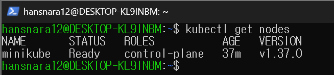
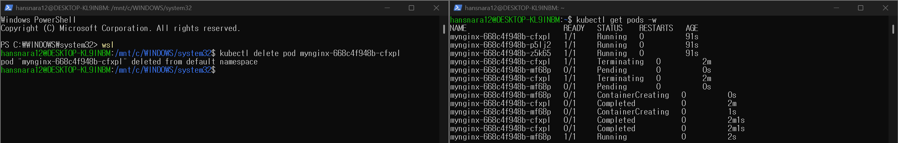
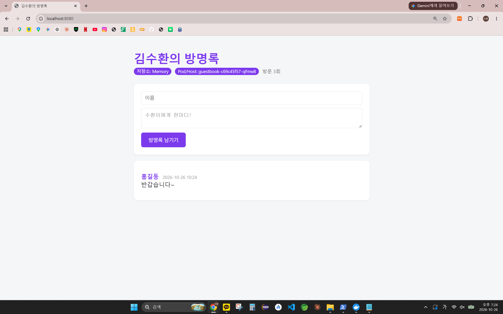
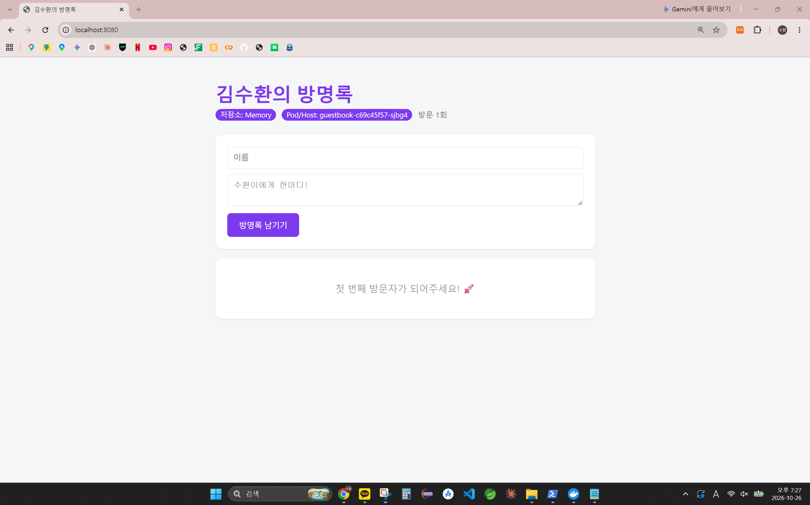

# 9주차 - 쿠버네티스 첫 배포 (minikube)

노트북 안에 minikube로 쿠버네티스 클러스터를 만들고, Pod → Deployment(자가 치유) → 6주차에 GHCR에 올린 내 방명록 이미지 배포까지 진행했다.
"Pod 3개를 원한다"고 선언만 하면 쿠버네티스가 지워진 Pod를 알아서 새로 만드는 것을 직접 확인했다.

```
내 노트북 (WSL Ubuntu)
└── Docker Desktop
    └── [minikube 컨테이너] = 노드 1대
        ├── Control Plane (API Server, etcd, Scheduler, Controller)
        └── Pod: guestbook (ghcr.io/kimsuhwan1019/guestbook:v2)
kubectl ──명령──▶ API Server        localhost:8080 ──port-forward──▶ Pod:5000
```

## 오늘 배운 내용
- 컴포즈는 컴퓨터 1대까지, 여러 서버에 걸친 배치·복구·확장은 오케스트레이션(쿠버네티스)
- 명령형("이렇게 해라") vs 선언형("이런 상태를 원한다"), 조정 루프(관찰 → 비교 → 조치)
- 아키텍처: Control Plane(API Server, etcd, Scheduler, Controller) / Node(kubelet) / Pod
- kubectl 문장 구조(동사 + 종류 + 이름 + 옵션), docker 명령과의 대응
- `kubectl run`(Pod 하나) vs `create deployment`(개수 유지 → 자가 치유)
- Deployment → ReplicaSet → Pod 구조, Pod 이름 읽는 법
- Pod는 복구되지만 port-forward 연결과 Pod 안의 데이터는 복구되지 않음 (→ Service, 다음 시간)

상세는 맨 아래 개념 정리에.

## 새로 배운 명령어
```bash
# --- 설치 / 클러스터 ---
kubectl version --client                 # kubectl(리모컨) 버전 확인
minikube start --driver=docker           # 도커 컨테이너 하나를 노드로 클러스터 기동
minikube status                          # host / kubelet / apiserver 상태
minikube stop                            # 클러스터 중지 (삭제 아님)
kubectl get nodes                        # 노드 목록, STATUS Ready 확인
kubectl config current-context           # 지금 어느 클러스터에 명령하는지 확인

# --- 조회 / 진단 ---
kubectl get pods -A                      # 모든 네임스페이스 Pod (시스템 Pod 포함)
kubectl get pods -w                      # 실시간 관찰 (Ctrl+C 종료)
kubectl describe pod <이름>              # 상세 정보, 맨 아래 Events부터 읽기
kubectl logs <이름> / -l app=guestbook   # 로그 (이름 또는 레이블로)
kubectl exec -it <이름> -- bash          # Pod 안에서 명령 실행 (-- 뒤는 컨테이너 명령)
kubectl get deploy,rs,pods               # Deployment / ReplicaSet / Pod 한 번에

# --- 생성 / 변경 / 삭제 ---
kubectl run mynginx --image=nginx                         # Pod 하나 (명령형)
kubectl create deployment mynginx --image=nginx --replicas=3   # 3개 유지 선언
kubectl scale deployment mynginx --replicas=5             # 개수 변경
kubectl delete pod <이름> / deployment <이름>              # 삭제
kubectl port-forward deployment/guestbook 8080:5000       # 내 8080 → Pod 5000 (확인용)
```

## 실행 방법
```bash
minikube start --driver=docker                          # Docker Desktop 켠 뒤
kubectl get nodes                                       # Ready 확인
kubectl create deployment guestbook --image=ghcr.io/kimsuhwan1019/guestbook:v2
kubectl get pods -w                                     # Running 되면 Ctrl+C
kubectl port-forward deployment/guestbook 8080:5000     # 브라우저 http://localhost:8080
```
종료: `Ctrl+C` → `kubectl delete deployment guestbook` → `minikube stop`

## 파일 구성
```
week09/
├── README.md                     # 이 문서
└── images/
    ├── 01-get-nodes.png          # minikube 노드 Ready
    ├── 02-self-healing.png       # Pod 삭제 후 새 Pod 생성 (get pods -w)
    ├── 03-guestbook-before.png   # 방명록 Pod qfmw8 + 글 1개
    └── 04-guestbook-after.png    # Pod 삭제 후 sjbg4, 글·방문 수 초기화
```
이번 주는 kubectl 명령으로만 배포해서 새 코드 파일은 없음. 이미지는 6주차 `guestbook:v2` 재사용.

## 실행 결과
사용 도구: **minikube v1.39.0** (driver=docker), kubectl v1.37.1, Kubernetes v1.37.0

**1. 클러스터 기동** — `minikube   Ready   control-plane`



**2. 자가 치유** — `kubectl run`으로 만든 Pod는 지우니 `No resources found`, Deployment(replicas=3)는 `cfxpl` 삭제 직후 `mf68p`가 `Pending → ContainerCreating → Running`. `delete pods --all` 후에도 다시 3개.



**3. 내 방명록을 쿠버네티스에서** — 저장소 Memory, Pod/Host에 Pod 이름 표시

| 삭제 전 | 삭제 후 (`kubectl delete pod -l app=guestbook`) |
|---|---|
|  |  |
| Pod `qfmw8`, 글 1개, 방문 3회 | Pod `sjbg4`, 글 0개, 방문 1회 |

- 이름이 바뀜 → 되살린 게 아니라 **새로 만든 Pod**
- 글·방문 수 초기화 → Pod 안(메모리) 데이터는 Pod와 함께 사라짐
- port-forward는 `error: lost connection to pod`로 끊겨 다시 실행해야 했음

**선언형 한 줄 (내 언어로)**: 에어컨에 "26도"만 정해두면 알아서 켜고 끄듯, 쿠버네티스에 "Pod 3개"만 적어두면 모자랄 때 알아서 채운다.

## 막혔던 부분
- **kubectl 설치에서 sudo 비밀번호 3회 실패** → 2주차에 정한 WSL 비밀번호를 잊음. PowerShell에서 `wsl -u root passwd hansnara12`로 재설정. 또 설치 블록을 통째로 붙여넣어 sudo 실패 후 `rm kubectl`까지 실행돼 다운로드 파일이 지워짐 → sudo가 들어간 명령은 한 줄씩
- **설치 전인데 `kubectl version`이 v1.36.1로 나옴** → Docker Desktop이 넣어둔 kubectl이었음. 교안대로 설치 후 `ls -l /usr/local/bin/kubectl`에 화살표 없이 `root root`, v1.37.1 확인
- **`wsl: command not found`** → `wsl -u root ...`를 우분투 안에서 실행함. `exit`로 PowerShell에 나와서 실행
- **7주차 compose 컨테이너(guestbook-web-1~3)가 떠 있음** → 8080 충돌 방지로 `docker compose down` (볼륨은 유지)
- **방명록 대신 nginx 환영 페이지가 보임** → 같은 `localhost:8080`이라 브라우저 캐시. `Ctrl+Shift+R`로 해결
- **Pod 삭제 후 port-forward가 바로 안 끊김** → 브라우저 요청이 들어와야 `lost connection`이 뜸
- **글 시간이 9시간 늦게 찍힘** → 컨테이너 기본 시간대 UTC (6·7주차와 같음)
- 교안 50p(이미지 다운로드 실패 우회)는 GHCR 패키지가 Public이라 필요 없었음. 교안은 `guestbook:v1`이지만 6주차에 올린 `v2` 사용

---

<details>
<summary><b>개념 정리</b> (클릭해서 펼치기)</summary>

### 왜 쿠버네티스인가 (16~19p)
- 컴포즈의 아쉬움: 컴퓨터 1대 안에서만, 호스트 고장 시 다른 노드로 이동 X, 트래픽에 따른 자동 확장 X, 무중단 배포는 직접 구현, 서버 여유는 직접 계산
- `docker run`(개별) → `docker compose`(여러 개, 1대) → Kubernetes(수백 개, 수십 대, 자동으로)
- 어원: 그리스어 "조타수", K와 s 사이 8글자라 k8s. 2015년 7월 정식 출시
- 오케스트레이션: 여러 서버의 컨테이너를 자동으로 배치·관리. 사실상 표준이 쿠버네티스 (Docker Swarm도 있지만 업계는 쿠버네티스로 수렴)
- 실무는 EKS, GKE 같은 관리형 클러스터. kubectl과 YAML은 동일

### 명령형 vs 선언형 (20~22p)
| | 명령형 (Imperative) | 선언형 (Declarative) |
|---|---|---|
| 말투 | "이렇게 해라" | "이런 상태를 원한다" |
| 예 | `docker run -d nginx` 3번 | `replicas: 3` |
| 컨테이너가 죽으면 | 내가 다시 run | 쿠버네티스가 알아서 살림 (자가 치유) |
| 지시하는 것 | **어떻게** | **무엇을** |

- 도커 `--restart=always`, 컴포즈 `restart: always`도 재시작은 하지만, 쿠버네티스는 원하는 **개수**를 계속 지켜보며 맞춤
- 비유: 명령형 사장은 직원이 아프면 다시 지시 / 선언형 사장은 "주방 2명, 홀 3명"만 정하고 매니저가 관리
- 일상 속 선언형: 에어컨 26도, 내비게이션 목적지, 택시 "인하공전으로 가주세요"

### 조정 루프 (23p)
- 1. 관찰: 지금 Pod 2개 → 2. 비교: 원하는 건 3개, 1개 부족 → 3. 조치: 1개 생성 → 다시 관찰
- 원하는 상태(Desired State) / 현재 상태(Actual State) / 조정(Reconciliation): 차이를 없애는 방향으로

### 아키텍처 (24~26p)
| 구성 요소 | 하는 일 | 식당 비유 |
|---|---|---|
| API Server | 모든 요청을 받는 창구 (kubectl이 말 거는 곳) | 본사 접수 창구 |
| etcd | 클러스터의 모든 상태 기록 | 본사 장부 |
| Scheduler | 새 Pod를 어느 노드에 둘지 결정 | 직원 배치 |
| Controller | 원하는 상태와 현재를 비교해 맞춤 | 본사 매니저 |
| Node | 컨테이너가 실제로 도는 서버 | 각 지점 |
| kubelet | 노드에서 Pod를 실제로 띄움 (1노드 1kubelet) | 지점장 |
| Pod | 컨테이너를 감싼 최소 단위 | 직원 |

`kubectl run` 한 줄이 Pod가 되는 과정: kubectl → API Server → etcd 기록 → Scheduler가 노드 결정 → kubelet이 이미지 받고 실행 → API Server에 Running 보고 → `get pods`가 장부를 읽어 보여줌. **kubectl은 등록만 하고 실행은 kubelet이 함**

### Pod와 네임스페이스 (27~28p)
- Pod 안의 컨테이너는 네트워크(IP, 포트)를 공유. 앱 + 로그 수집기처럼 붙어 다녀야 하는 경우가 있어 Pod로 감쌈. 대부분은 Pod 1개 = 컨테이너 1개
- 네임스페이스: 클러스터 안의 칸막이. `-n 이름`, 전체는 `-A`. 만들었는데 안 보이면 다른 구역 확인
- 쿠버네티스 자신도 kube-system의 Pod로 돈다 (etcd, kube-apiserver, kube-scheduler, coredns 등)

### kubectl 읽기 (33~40p)
- `kubectl get pods mynginx -o wide` = 리모컨 / 동사 / 종류 / 이름 / 옵션
- 동사: get, describe, logs, exec, run/create, delete. 종류 줄임: po, deploy, ns
- 옵션: `-o wide`, `-w`, `-A`, `-n`, `-l`
- STATUS: Pending → ContainerCreating → Running. RESTARTS가 자꾸 오르면 이상 신호
- describe의 Events는 아래부터 읽기. 실행 안 되면 Events, 프로그램 오류는 logs
- docker ↔ kubectl: `run`↔`run --image`, `ps`↔`get pods`, `inspect`↔`describe`, `logs`↔`logs`, `exec -it`↔`exec -it -- `, `-p`↔`port-forward`, `rm -f`↔`delete pod`

### 자가 치유와 Deployment (42~47p)
| 상황 | `kubectl run`의 Pod | Deployment의 Pod |
|---|---|---|
| 컨테이너 비정상 종료 | 재시작 가능 | 재시작 가능 |
| Pod 자체를 삭제 | 복구 안 됨 | 새 Pod 생성 |
| 복제본 개수 유지 | 불가능 | 가능 |

- Deployment(개수·업데이트 방식) → ReplicaSet(개수 유지) → Pod
- 이름 `mynginx-668c4f948b-cfxpl` = Deployment - ReplicaSet 해시 - 무작위
- 새 Pod는 되살린 게 아니라 새로 만든 것 → Pod 안 데이터는 사라짐, 데이터는 밖에
- `scale`로 숫자는 유지되지만 명령으로만 바꾸면 왜 그 숫자인지 이력이 안 남음 → 다음 시간(YAML)

### 내 이미지와 Service 예고 (48~55p)
- `create deployment guestbook --image=...` 하면 레이블 `app=guestbook`이 자동으로 붙음
- `port-forward deployment/guestbook 8080:5000`은 Deployment의 Pod **하나**에 연결 → 그 Pod가 지워지면 끊김
- Deployment는 Pod를 유지, **Service**는 Pod에 접근하는 안정적인 경로 제공 → 다음 시간
- 막히면: `get pods` → `describe pod`(Events) → `logs`
- `ErrImagePull → ImagePullBackOff`: private 패키지 / 이름·태그 오타 / 네트워크. 우회는 `docker pull` → `minikube image load` → `kubectl delete pod -l app=guestbook`
- 끝내기: `minikube stop`(중지, 다시 start 가능) / `minikube delete`(통째로 삭제)

</details>
