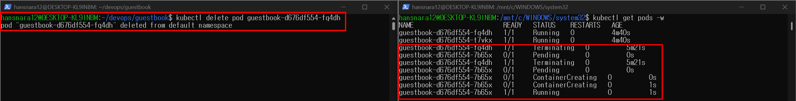
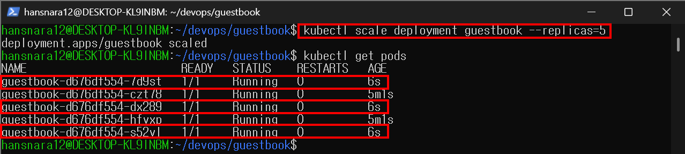
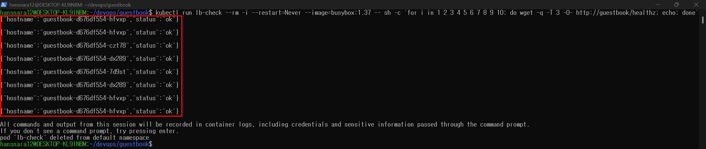
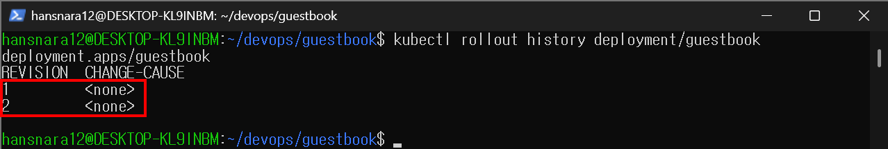
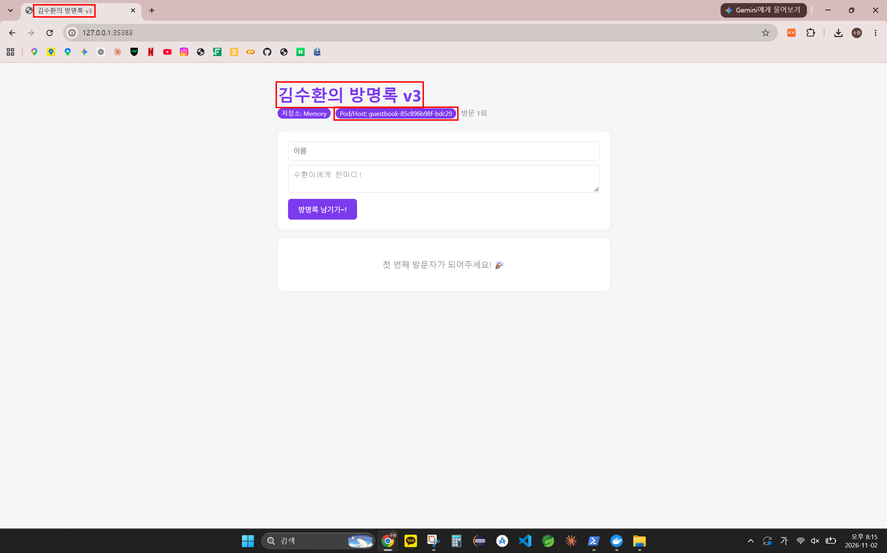
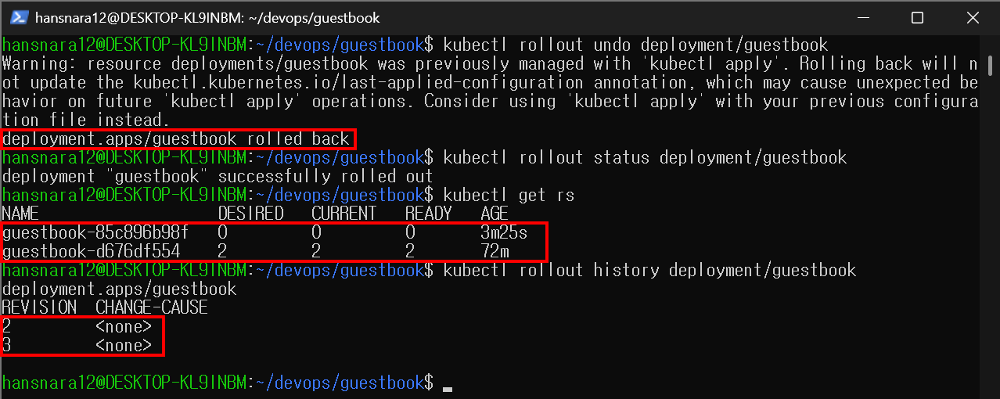

# 10주차 - 쿠버네티스 Deployment와 Service

방명록을 명령(`kubectl create`)이 아니라 YAML 파일(`deployment.yaml`, `service.yaml`)로 선언해서 배포했다.
Service로 고정 주소와 로드밸런싱을 붙이고, 스케일링 → v3 롤링 업데이트 → 롤백까지 서비스를 멈추지 않고 진행했다.

```
kubectl apply -f k8s/
        │
        ├─▶ [Deployment: guestbook] replicas 2, image v2
        │        └─▶ [ReplicaSet] ─▶ [Pod] [Pod]   (app=guestbook)
        │                              ▲
        └─▶ [Service: guestbook] NodePort 30080 ─┘ selector: app=guestbook
```

## 오늘 배운 내용

- 명령형(`kubectl create`)에서 선언형(YAML + `kubectl apply`)으로: apply는 몇 번을 해도 같은 결과(멱등성)
- Deployment → ReplicaSet → Pod 3층 구조. 내가 만드는 건 Deployment 하나
- 레이블과 셀렉터: `matchLabels`, `template.labels`, Service `selector` 세 곳이 같아야 연결된다
- Service: Pod IP가 바뀌어도 고정된 이름·IP를 주고, 요청을 Pod들에 나눠 보낸다
- 포트 세 개: `nodePort`(바깥 문) → `port`(서비스의 문) → `targetPort`(컨테이너의 문)
- 롤링 업데이트(새 ReplicaSet으로 하나씩 교체)와 롤백(이전 ReplicaSet 복원)
- 「왜 굳이」: 도구를 외우기보다 각 도구가 어떤 문제를 해결하는지 설명할 수 있어야 한다

상세는 맨 아래 개념 정리에

## 새로 배운 명령어

```bash
# --- YAML로 배포 ---
kubectl apply -f k8s/deployment.yaml --dry-run=server    # 실제로 만들지 않고 문법·규칙만 검사
kubectl apply -f k8s/deployment.yaml                     # 파일에 적은 상태로 맞추기 (변경 없으면 unchanged)
kubectl get deployments                                  # Deployment 목록 (READY 2/2)
kubectl get rs                                           # ReplicaSet 목록 (DESIRED/CURRENT/READY)
kubectl get all                                          # Pod, Service, Deployment, ReplicaSet 한눈에
kubectl delete -f k8s/                                   # 폴더 안 매니페스트로 만든 것 전부 삭제

# --- 레이블 ---
kubectl get pods --show-labels                           # Pod에 붙은 레이블 보기
kubectl delete pods -l app=guestbook                     # 이름 몰라도 레이블로 골라 삭제

# --- 서비스 ---
kubectl get svc                                          # 서비스 목록 (80:30080/TCP)
kubectl describe svc guestbook                           # Endpoints = 레이블로 찾은 Pod IP들
minikube service guestbook                               # 접속 주소 열기 (터미널 유지)

# --- 스케일링과 로드밸런싱 ---
kubectl scale deployment guestbook --replicas=5          # Pod 개수 변경 (명령 방식)
kubectl run lb-check --rm -i --restart=Never --image=busybox:1.37 -- \
  sh -c 'for i in 1 2 3 4 5 6 7 8 9 10; do wget -q -T 3 -O- http://guestbook/healthz; echo; done'
                                                         # 클러스터 안에서 서비스로 10번 요청

# --- 롤링 업데이트와 롤백 ---
kubectl set image deployment/guestbook web=ghcr.io/kimsuhwan1019/guestbook:v3   # 이미지 교체
kubectl rollout status deployment/guestbook              # 교체가 끝날 때까지 진행 상황 표시
kubectl rollout history deployment/guestbook             # 버전(REVISION) 목록
kubectl rollout undo deployment/guestbook                # 바로 이전 버전으로 되돌리기
```

## 실행 방법

```bash
minikube start --driver=docker                # Docker Desktop을 먼저 켠다
cd ~/devops/guestbook
kubectl apply -f k8s/deployment.yaml          # Pod 2개 생성
kubectl apply -f k8s/service.yaml             # NodePort 30080 서비스 생성
kubectl get pods                              # 2개 Running 확인
minikube service guestbook                    # 표시된 http://127.0.0.1:xxxxx 로 접속
# 종료: Ctrl+C → kubectl delete -f k8s/ → minikube stop
```

## 파일 구성

```
devops/
├── guestbook/
│   ├── k8s/
│   │   ├── deployment.yaml      # replicas 2, image guestbook:v2, 레이블 app=guestbook
│   │   └── service.yaml         # NodePort: 30080 → 80 → 5000
│   └── templates/index.html     # 제목에 v3 추가 (롤링 업데이트용 v3 이미지 빌드에 사용)
└── week10/
    ├── README.md
    └── images/                  # 실행 결과 캡처 6장
```

## 실행 결과

환경: minikube v1.39.0 / Kubernetes v1.37.0 / 이미지 `ghcr.io/kimsuhwan1019/guestbook:v2`, `v3`

**1. YAML 배포와 멱등성**

- `apply` → `created`, 같은 파일로 다시 `apply` → `unchanged`
- `replicas: 3`으로 고치고 `apply` → `configured`. 기존 Pod 2개(2m31s)는 그대로 두고 새 Pod 1개(13s)만 추가됨
- 이름 구조: `guestbook-d676df554-fq4dh` = Deployment 이름 + ReplicaSet 해시 + 무작위 5글자

**2. 자가 치유** — Pod를 지우자 1초 만에 같은 틀(`d676df554`)로 새 Pod 생성



- `kubectl delete pods -l app=guestbook`로 2개를 한꺼번에 지워도 새 이름으로 다시 2개
- `--show-labels` → `app=guestbook,pod-template-hash=d676df554`

**3. Service**

- `get svc` → `guestbook  NodePort  10.107.77.238  <none>  80:30080/TCP`
- `describe svc` Endpoints `10.244.0.8:5000, 10.244.0.7:5000` = `get pods -o wide`의 Pod IP 2개와 일치
- `minikube service` → `http://192.168.49.2:30080`(노드 주소)과 터널 주소 `http://127.0.0.1:35383` 표시
- 브라우저 새로고침 시 Pod/Host가 `czt78` ↔ `hfvxp`로 바뀌고, 한쪽에만 글이 보임 (저장소 Memory → Pod마다 데이터가 따로)

**4. 스케일링과 로드밸런싱**





- 로드밸런서를 따로 설정하지 않았는데 4개 Pod(`hfvxp`, `czt78`, `dx289`, `7d9st`)로 요청이 나뉨
- `scale`로 5개인 상태에서 `apply -f k8s/deployment.yaml` → `configured`, 다시 2개 (파일 쪽이 기준)

**5. 롤링 업데이트 (v2 → v3)**

- `set image` 후 새 ReplicaSet `85c896b98f` 생성: 새 Pod Running → 옛 Pod Terminating을 하나씩 반복
- 교체 중 1초마다 보낸 요청이 전부 `HTTP/1.1 200 OK` (무중단). 응답 `Content-Length`가 55 → 56으로 바뀌는 시점에 새 Pod가 응답 시작 (새 해시가 1글자 길어서 hostname이 길어짐)
- `get rs` → `85c896b98f 2 2 2` / `d676df554 0 0 0` (옛 틀은 0으로 보관)





**6. 롤백**



- 다시 빌드하지 않고 보관된 `d676df554`를 2로 되살림. history는 1이 3으로 다시 붙어 `2, 3`
- 이후 브라우저 확인을 위해 v3 재배포 → `apply -f k8s/deployment.yaml`로 v2 복귀 (history `4, 5`)
- 최종 `get all`: Pod 2개(v2), Service CLUSTER-IP `10.107.77.238` 그대로. Pod를 여러 번 교체해도 서비스 주소는 처음 그대로

## 막혔던 부분

- **v1 → v2가 아니라 v2 → v3로 진행**: 6주차 과제 이미지가 이미 `v2`라서, 교안대로 v2를 다시 빌드하면 덮어쓰게 됨. v2로 배포하고 제목에 v3를 붙인 이미지로 롤링 업데이트함
- **Pod를 지우면 약 30초 Terminating 후 `Error`**: 앱이 종료 신호(SIGTERM)에 반응하지 않아 기본 유예 시간 30초 뒤 강제 종료되는 것으로 보임 (추측). 새 Pod는 바로 생성되므로 서비스에는 영향 없음
- **접속 포트가 30080이 아니라 35383**: WSL + Docker 드라이버에서는 노드 IP(192.168.49.2)로 바로 접속이 안 돼서 `minikube service`가 터널을 열어 줌. 터미널을 닫으면 접속이 끊김
- **lb-check 결과가 10줄이 아니라 8줄**: `-i`로 출력에 연결되기 전에 앞의 몇 줄이 지나간 것으로 보임 (추측). 화면의 `If you don't see a command prompt...`가 그 안내
- **`rollout undo` 후 Warning**: apply로 관리하던 Deployment를 undo하면 apply 기록(last-applied-configuration)이 갱신되지 않는다는 경고. 파일도 v2라 실제 문제는 없었고, 이후 v2 복귀는 `apply -f`로 해서 경고 없이 끝남 → 명령보다 파일로 관리해야 하는 이유
- **v3 화면에서 제목 외에 버튼 문구·이모지도 바뀜**: v2는 6주차 코드로, v3는 지금 폴더(7주차에 수정된 코드)로 빌드했기 때문. 이미지는 빌드 시점의 폴더 전체를 담는다
- **글을 너무 많이 남겨서 초기화**: `kubectl delete pods -l app=guestbook`로 Pod를 새로 만들어 메모리 저장소를 비움
- 글 작성 시간이 9시간 늦게 표시됨 → 컨테이너 시간대가 UTC (9주차와 같음)

---

<details>
<summary><b>개념 정리</b> (클릭해서 펼치기)</summary>

### 기말 종합평가 대비

**(1) 선언형 vs 명령형** (9주차 교수님 강조)

| | 명령형 | 선언형 |
|---|---|---|
| 말투 | "이렇게 해라" | "이런 상태를 원한다" |
| 예 | `docker run` × 3, `kubectl create deployment` | `replicas: 3` + `kubectl apply -f` |
| 죽으면 | 사람이 다시 실행 | 쿠버네티스가 원하는 상태로 맞춤 (조정 루프) |

**(2) 자가 치유 관점의 차이** (08번 교안 69p)

- (a) `kubectl run web --image=nginx` → Pod 하나만. 지우면 그대로 사라짐 (지켜보는 상위 컨트롤러 없음)
- (b) `kubectl create deployment web --image=nginx --replicas=2` → "2개 있어야 해" 선언. 지워지면 새로 만들어 2개 유지

**(3) 출력 읽기** (08번 교안 70p)

```
NAME                        READY   STATUS             RESTARTS   AGE
guestbook-6b8d9f7c4-x2k9p   0/1     ImagePullBackOff   0          3m
```

- 이미지를 받지 못한 상태 → `kubectl describe pod guestbook-6b8d9f7c4-x2k9p` → 맨 아래 Events
- 흔한 원인: 이미지 이름·태그 오타, ghcr 패키지가 private

### 현장에서는 (08번 교안 57~65p)

- 회사도 같은 kubectl을 쓴다. 다른 점은 관리형 클러스터(EKS/GKE/AKS), 사내 레지스트리, CI/CD + GitOps, 모니터링 알림
- 클러스터는 dev / staging / prod 여러 개 → 명령 전 `kubectl config current-context` 확인
- 네임스페이스로 팀별 구역과 자원 상한을 나눈다
- 장애 시 순서: 알림 → 대시보드 → get/describe/logs → **먼저 되돌리기**(rollout undo) → 원인 분석 → 회고(사람 탓 금지)
- 작은 서비스는 compose, 운영 인력이 없으면 서버리스, 큰 규모는 쿠버네티스

### 3층 구조와 어원

| 오브젝트 | 비유 | 하는 일 |
|---|---|---|
| Deployment | 사장 | 버전·개수·교체 방법 선언 (우리가 만드는 것) |
| ReplicaSet | 매니저 | 같은 Pod 복제본 개수 유지 (자동 생성) |
| Pod | 직원 | 실제 컨테이너 실행 단위 |

- `template` = 붕어빵 틀(Pod 설계도). 틀이 바뀌면(이미지 변경) 새 ReplicaSet으로 다시 굽고(롤링 업데이트), 하나를 먹으면(삭제) 같은 틀로 다시 굽는다(자가 치유)

### YAML에서 기억할 4가지

| 필드 | 의미 | 예 |
|---|---|---|
| apiVersion | API 버전 | Deployment `apps/v1`, Service `v1` |
| kind | 무엇을 만들까 | Deployment, Service |
| metadata | 이름표 | `name: guestbook` |
| spec | 원하는 상태 | replicas, template / type, ports |

- 가장 실수가 잦은 곳: `selector.matchLabels` = `template.metadata.labels`
- Service의 selector에는 `matchLabels:`가 없다 (바로 레이블)
- Deployment 레이블이 틀리면 apply 실패, Service 레이블이 틀리면 에러 없이 접속만 안 됨 → `describe svc`의 Endpoints 확인

### Service

| 타입 | 설명 | 언제 |
|---|---|---|
| ClusterIP | 클러스터 내부 전용 (기본값) | DB 등 |
| NodePort | 노드 포트(30000~32767)로 외부 노출 | 수업·개발 |
| LoadBalancer | 클라우드 로드밸런서 연결 | 실무 |

```
브라우저 → [Node] nodePort 30080 → [Service] port 80 → [Pod] targetPort 5000
```

- 서비스 이름 = 클러스터 안 DNS 주소: `guestbook` / `guestbook.default` / `guestbook.default.svc.cluster.local`
- 7주차 nginx 문지기와 비교: nginx.conf 직접 작성 → selector + ports 몇 줄, 새 Pod 자동 추적

### create vs apply

| | create | apply |
|---|---|---|
| 의미 | 새로 만들어라 | 이 상태가 되게 해라 |
| 이미 있으면 | AlreadyExists 에러 | 차이만 반영 (없으면 unchanged) |
| 사고 방식 | 명령형 | 선언형 |

- 숫자·이미지 변경은 실습에서는 명령(`scale`, `set image`)으로 빠르게, 팀 프로젝트에서는 파일 수정 + `apply` + Git 커밋 (왜 바뀌었는지 기록이 남음)

### 롤링 업데이트와 롤백

| 단계 | 옛 ReplicaSet | 새 ReplicaSet | 요청 받는 Pod |
|---|---|---|---|
| 시작 | ● ● | - | 2 |
| 1 | ● ● | ○ 추가 | 2 |
| 2 | ● (하나 삭제) | ● 준비 완료 | 2 |
| 3 | ● | ● ○ 하나 더 | 2 |
| 끝 | 0개 | ● ● | 2 |

| 명령 | 하는 일 |
|---|---|
| `rollout status` | 교체가 끝날 때까지 진행 상황 표시 |
| `rollout history` | 버전(REVISION) 목록 |
| `rollout undo` | 바로 이전 버전으로 (`--to-revision=N`으로 지정 가능) |

- 롤백은 이전 ReplicaSet을 다시 키우는 것. 다시 빌드할 필요 없음 (단, 무제한 보관은 아님)
- 되돌리면 새 번호가 붙고 기록은 쌓인다 → `git revert`와 비슷 (`git reset`은 기준점을 과거로 옮김)

### 왜 굳이 (10번 교안)

| 도구 | 해결하는 문제 |
|---|---|
| Git / GitHub | 코드를 어떻게 기록하고 공유할까 |
| WSL / 우분투 | 리눅스 개발 환경을 어떻게 준비할까 |
| 도커 / 컴포즈 | 실행 환경과 여러 서비스를 어떻게 관리할까 |
| 쿠버네티스 | 컨테이너 수와 서비스를 원하는 상태로 어떻게 유지할까 |

- 정답은 하나가 아니다. 혼자 하는 작은 실습은 파이썬 직접 실행으로도 충분하고, 복제본·장애 복구가 필요해질 때 쿠버네티스를 고려한다
- Pod 복제와 서비스 무중단은 다른 개념이다
- AI가 명령을 대신 실행해도, 명령의 의미를 알아야 결과를 검토할 수 있다

</details>
