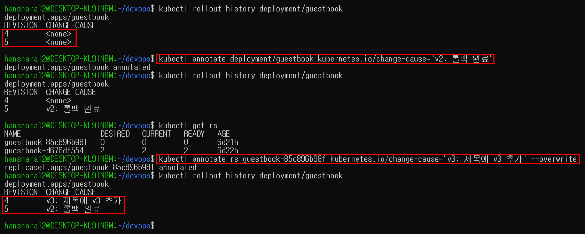
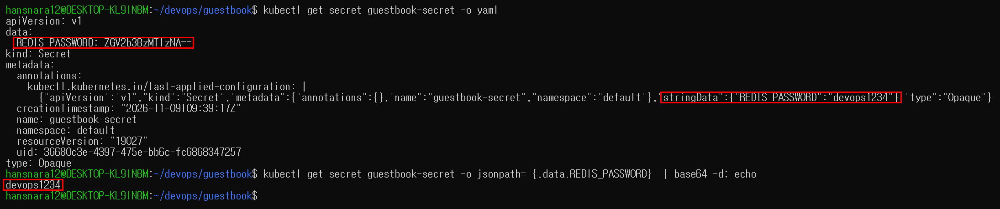
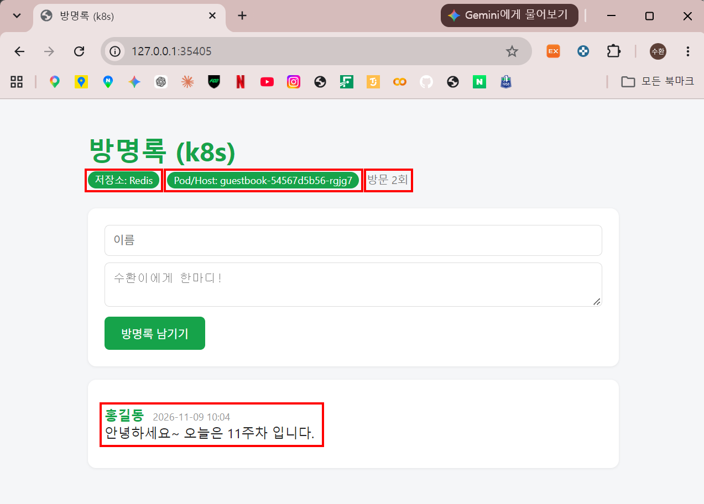
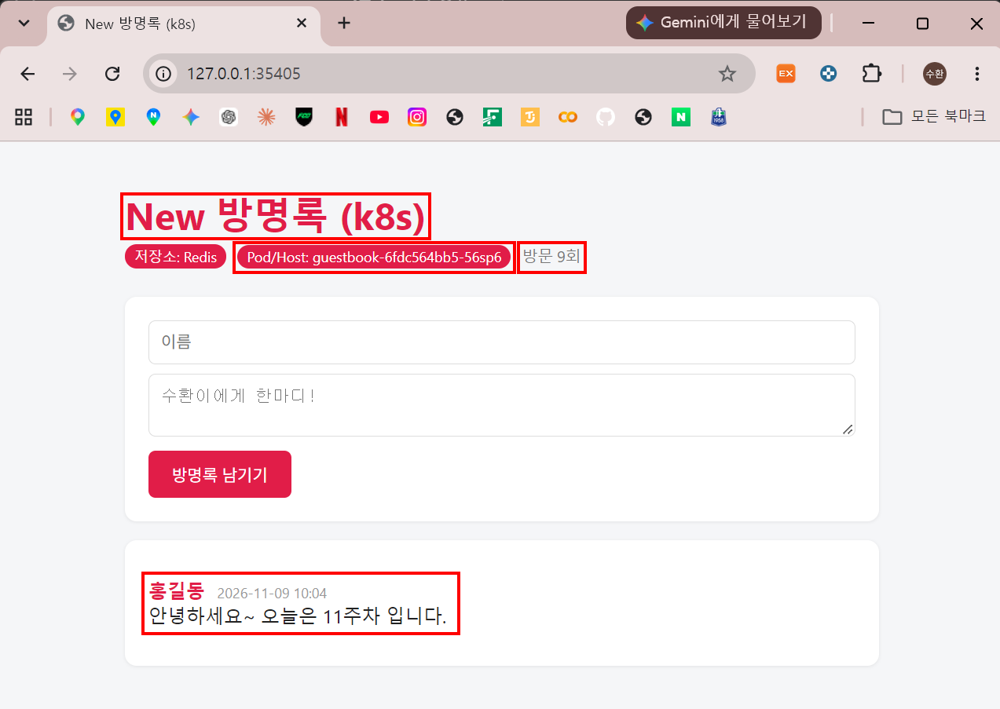
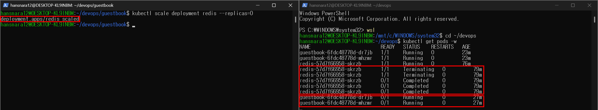
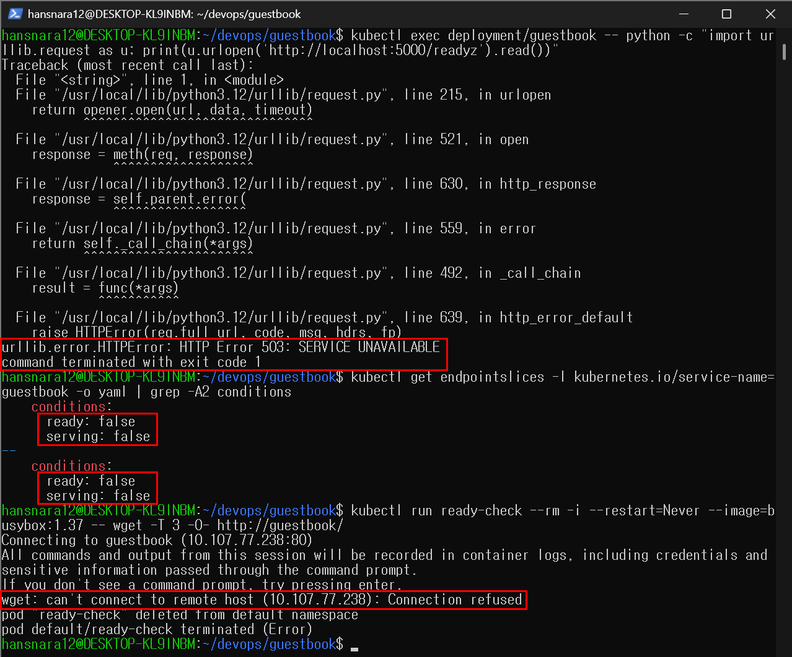
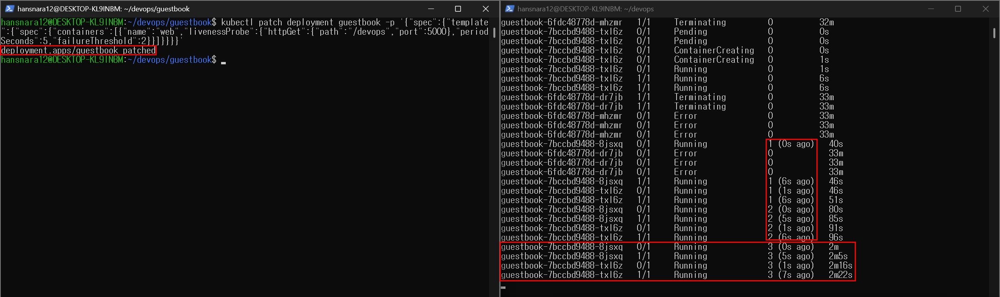
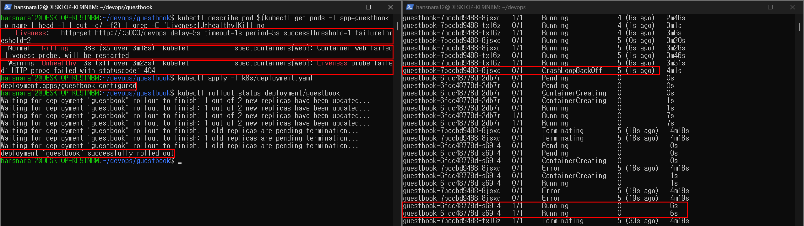

# 11주차 - ConfigMap, Secret, probe

방명록 이미지는 그대로 두고 설정(ConfigMap)과 비밀번호(Secret)를 바깥에서 주입했다. Redis를 붙여 여러 Pod가 같은 글을 보게 하고(무상태 + 공유 DB), 이미지 빌드 없이 ConfigMap만 바꿔 제목과 색을 바꿨다.
liveness/readiness probe를 넣고 일부러 실패시켜서, readiness 실패는 트래픽만 끊고 liveness 실패는 재시작한다는 차이를 직접 확인했다.

```
[ConfigMap: guestbook-config] ─ envFrom ─┐
[Secret: guestbook-secret] ─── envFrom ──┤
                                         ▼
[Deployment: guestbook] Pod × 2 (probe: /healthz, /readyz) ──▶ [Service: redis] ClusterIP 6379
                                                                       │
[Secret] ─ env.valueFrom ─▶ [Deployment: redis] --requirepass ◀────────┘
```

## 오늘 배운 내용

- 롤아웃 기록에 이유 남기기: `kubectl annotate ... kubernetes.io/change-cause` (09번 교안 53~55p)
- `git revert`는 취소 기록을 새로 쌓고, `git reset`은 기준점을 과거로 옮긴다
- 설정은 이미지 밖에: 같은 이미지에 ConfigMap만 바꿔서 다른 환경으로 (Build once, run anywhere)
- Secret은 암호화가 아니라 base64 인코딩이다. 권한만 있으면 누구나 원래 값을 볼 수 있다
- 환경 변수는 Pod가 시작할 때 한 번 읽는다 → ConfigMap을 고치면 `rollout restart`가 필요하다
- requests(필요량) / limits(상한). 메모리 limit을 넘으면 OOM kill, CPU는 느려질 뿐
- liveness 실패 = 컨테이너 재시작 / readiness 실패 = 트래픽만 차단 (재시작 아님)

상세는 맨 아래 개념 정리에

## 새로 배운 명령어

```bash
# --- 롤아웃 기록 ---
kubectl rollout history deployment/guestbook                                      # 버전 목록과 CHANGE-CAUSE
kubectl annotate deployment/guestbook kubernetes.io/change-cause="이유" --overwrite # 현재 버전에 메모
kubectl annotate rs <ReplicaSet이름> kubernetes.io/change-cause="이유" --overwrite  # 지난 버전에 메모

# --- base64 ---
echo -n devops1234 | base64                     # 인코딩 (-n: echo의 줄바꿈 제외)
echo ZGV2b3BzMTIzNA== | base64 -d               # 디코딩 = 원래 값 복구

# --- ConfigMap / Secret ---
kubectl get cm,secret                                                              # ConfigMap, Secret 목록
kubectl get secret guestbook-secret -o yaml                                        # 오브젝트 전체를 YAML로
kubectl get secret guestbook-secret -o jsonpath='{.data.REDIS_PASSWORD}' | base64 -d; echo  # 값 하나만 꺼내 디코딩
kubectl exec deploy/guestbook -- printenv APP_TITLE THEME_COLOR REDIS_HOST          # Pod 안 환경 변수 확인 (비밀 제외)
kubectl edit configmap guestbook-config                                            # 클러스터의 ConfigMap 직접 수정 (vi)
kubectl rollout restart deployment guestbook                                       # 같은 설정으로 Pod를 하나씩 새로 → 새 값 읽기

# --- 상태 점검 ---
kubectl logs -l app=guestbook | grep Redis                                        # 레이블로 고른 Pod들의 로그에서 Redis 줄만
kubectl get pods -w                                                               # 상태가 바뀔 때마다 새 줄로 계속 출력
kubectl scale deployment redis --replicas=0                                       # Redis 끄기 (readiness 실패 실험)
kubectl get endpointslices -l kubernetes.io/service-name=guestbook -o yaml        # 서비스가 요청을 보낼 Pod 명단 (ready: true/false)
kubectl patch deployment guestbook -p '{"spec":{...}}'                            # 파일 없이 실행 중인 리소스 일부만 수정
kubectl describe pod <이름> | grep -E "Liveness|Unhealthy|Killing"                 # probe 설정과 실패 이벤트만
```

## 실행 방법

```bash
minikube start --driver=docker                          # Docker Desktop을 먼저 켠다
cd ~/devops/guestbook
cp k8s/secret.yaml.example k8s/secret.yaml              # 비밀번호 파일은 저장소에 없으니 example로 만든다
nano k8s/secret.yaml                                    # CHANGE_ME를 원하는 비밀번호로
kubectl apply -f k8s/configmap.yaml -f k8s/secret.yaml -f k8s/redis.yaml
kubectl apply -f k8s/deployment.yaml -f k8s/service.yaml
kubectl get pods                                        # guestbook 2개, redis 1개 1/1 Running
minikube service guestbook                              # 표시된 http://127.0.0.1:xxxxx 로 접속
# 종료: Ctrl+C → kubectl delete -f k8s/ → minikube stop
```

## 파일 구성

```
devops/
├── .gitignore                       # guestbook/k8s/secret.yaml 추가 (진짜 비밀번호 파일은 올리지 않음)
├── guestbook/
│   └── k8s/
│       ├── configmap.yaml           # APP_TITLE, THEME_COLOR, REDIS_HOST, REDIS_PORT (값은 전부 따옴표)
│       ├── secret.yaml.example      # REDIS_PASSWORD: "CHANGE_ME" (양식만)
│       ├── redis.yaml               # Deployment(redis:7-alpine, --requirepass) + Service(ClusterIP 6379)
│       ├── deployment.yaml          # envFrom + resources + livenessProbe(/healthz) + readinessProbe(/readyz)
│       └── service.yaml             # NodePort 30080 (10주차 그대로)
└── week11/
    ├── README.md
    └── images/                      # 실행 결과 캡처 9장
```

## 실행 결과

환경: minikube v1.39.0 / Kubernetes v1.37.0 / 이미지 `ghcr.io/kimsuhwan1019/guestbook:v2` / `redis:7-alpine`

| 과제 (11번 교안 50p) | 위치 |
|---|---|
| Secret을 `base64 -d`로 읽은 화면 + 왜 안전하지 않은지 | 2번 |
| ConfigMap만 변경해서 제목·색이 바뀐 화면 | 5번 |
| readiness 실패(READY 0/1) | 7번 |
| liveness 실패(RESTARTS 증가) | 8번 |
| 트러블슈팅 3단 루틴을 내 말로 | 10번 |

**1. 롤아웃 기록에 이유 남기기** (09번 교안 53~55p)



- 처음엔 REVISION 번호만 있고 CHANGE-CAUSE가 전부 `<none>` → 무엇이 바뀌었는지 알 수 없음
- 현재 버전(5)은 Deployment에, 지난 버전(4)은 그 ReplicaSet(`85c896b98f`)에 직접 메모
- 교안은 REVISION 2·3인데 나는 4·5: 지난주 롤백 후 한 번 더 배포했기 때문. 같은 ReplicaSet으로 돌아가면 옛 번호는 사라지고 새 번호를 받는다

**2. Secret은 잠근 게 아니다** (과제)



- `-o yaml`의 `data`에는 `ZGV2b3BzMTIzNA==`. 앞에서 `echo -n devops1234 | base64`로 만든 값과 똑같다
- `base64 -d` 한 번이면 `devops1234`. 열쇠가 필요 없으니 암호화가 아니라 표기만 바꾼 것(인코딩)
- 게다가 `stringData`로 만들어 `apply`했더니 `last-applied-configuration` 메모에 `"REDIS_PASSWORD":"devops1234"`가 **원문 그대로** 남아 있었다. 디코딩조차 필요 없다
- **왜 안전하지 않은가:** Secret을 읽을 권한만 있으면 누구나 비밀번호를 볼 수 있다. Secret이 해 주는 건 `get` 화면에 바로 안 보이게 하는 것과 설정·비밀을 나눠 관리하는 것뿐이다. 그래서 저장소에는 `secret.yaml` 대신 `secret.yaml.example`(CHANGE_ME)만 올렸다
- `-n` 없이 인코딩하면 `ZGV2b3BzMTIzNAo=`로 끝이 달라진다(줄바꿈까지 인코딩). `-n`으로 만든 값을 디코딩하면 줄바꿈이 없어서 프롬프트가 바로 뒤에 붙는다 → `; echo`를 붙이는 이유

**3. ConfigMap/Secret 만들고 Redis 붙이기**

- Redis Pod는 이미지를 처음 받느라 `ContainerCreating`(5s) → `1/1 Running`(2m2s). 로그 마지막 줄 `Ready to accept connections tcp`
- deployment.yaml에 `envFrom` 추가 후 apply → 두 Pod 모두 `[INFO] Redis 연결 성공: redis:6379`
- `printenv` → `방명록 (k8s)` / `#16a34a` / `redis` (ConfigMap 값이 환경 변수로)

**4. 무상태 앱 + 공유 DB**

새로고침으로 Pod가 바뀌어도 같은 글이 보인다. 10주차(저장소 Memory)에는 Pod마다 글이 달랐다.

| 새로고침 | Pod/Host | 글 | 방문 |
|---|---|---|---|
| A | `guestbook-54567d5b56-rgjg7` | 홍길동 "안녕하세요~ 오늘은 11주차 입니다." | 2회 |
| B | `guestbook-54567d5b56-5h6dd` | 같은 글 | 3회 |




- 방문 횟수도 Pod를 넘어 2 → 3으로 이어진다. 글과 카운터 모두 Redis 하나에 있다
- replicas를 4로 늘려도 새 Pod(`lsmj4`, `w5pp9`)가 바로 같은 Redis에 붙는다

**5. 이미지는 그대로, ConfigMap만 바꾸기** (과제)



- `kubectl edit`으로 APP_TITLE `New 방명록 (k8s)`, THEME_COLOR `#e11d48`
- edit 직후 새로고침 → **그대로 초록.** 떠 있는 Pod는 시작할 때 읽은 값을 계속 쓴다
- `rollout restart` 후 → 빨간 `New 방명록 (k8s)`. 이미지 빌드도, 코드 수정도 없었고 글도 남아 있다
- vi 화면 아래쪽 `last-applied-configuration`에는 옛 값(`#16a34a`)이 그대로 → edit은 내 파일과 Git에 반영되지 않는다. 그래서 `configmap.yaml`도 같은 값으로 고치고 `apply`해서 맞췄다

**6. probe 넣기**

- apply → 새 Pod 2개, 옛 Pod 4개 Terminating. scale로 늘린 4개가 파일의 `replicas: 2`로 돌아갔다
- describe → `Liveness: /healthz delay=5s period=10s failureThreshold=3`, `Readiness: /readyz delay=3s period=5s failureThreshold=3`

**7. readiness 실패: Redis를 끄면** (과제)





- `scale deployment redis --replicas=0` → guestbook 두 Pod 모두 **`0/1 Running`, RESTARTS 0**. 앱은 살아 있지만 준비 안 됨
- `/readyz` → `HTTP Error 503: SERVICE UNAVAILABLE`
- endpointslices → 두 Pod 모두 `ready: false` (서비스 명단에서 빠짐)
- 서비스로 요청 → `wget: can't connect to remote host (10.107.77.238): Connection refused`
- Redis를 1로 되돌리자 guestbook을 건드리지 않았는데 `0/1 → 1/1`. RESTARTS는 끝까지 0 → **재시작 없이 트래픽만 끊었다가 다시 연결**

**8. liveness 실패: probe 경로를 틀리면** (과제)





- `patch`로 liveness 경로를 없는 주소 `/devops`로 → 새 Pod의 RESTARTS가 1 → 2 → 3 … 5, 중간에 `CrashLoopBackOff`
- describe Events: `Liveness probe failed: HTTP probe failed with statuscode: 404` / `Killing (x5) Container web failed liveness probe, will be restarted`
- 앱은 멀쩡한데 경로 하나 틀려서 계속 죽었다. 재시작할 때마다 잠깐 `0/1`이 되는 건 새 컨테이너가 readiness를 다시 통과해야 해서
- 원복은 `apply -f k8s/deployment.yaml` 한 번. patch는 파일에 안 남으니 파일이 정답을 갖고 있다

**9. probe가 있는 롤링 업데이트**

- 새 Pod `0/1 Running`(1s) → `/readyz` 통과 후 `1/1`(7s) → **그다음에** 옛 Pod Terminating
- 지난주(probe 없음)는 켜지자마자 READY였다. 이제는 준비된 Pod에만 요청이 간다

최종 history:
```
4   v3: 제목에 v3 추가
5   v2: 롤백 완료
6   v2: ConfigMap/Secret 주입
7   v2: ConfigMap 제목·색 변경 후 restart
9   v2: liveness 경로 /devops patch (실패 실험)
10  v2: liveness/readiness probe 추가
11  v2: probe 적용 후 rolling restart
```

**10. 트러블슈팅 3단 루틴 (내 말로)** (과제)

Pod에 문제가 생기면 바로 고치려 하지 말고, **get → describe → logs 순서로 증거부터 모은다.**

1. **get pods: 어디가 이상한지 본다.** STATUS, READY, RESTARTS 세 칸만 봐도 방향이 잡힌다.
   - `Running`인데 `READY 0/1` → 살아는 있는데 준비가 안 됨 (오늘 7번: readiness 실패)
   - `RESTARTS`가 계속 오름 → 계속 죽었다 살아남 (오늘 8번: liveness 실패)
2. **describe pod: 쿠버네티스가 왜 그렇게 했는지 본다.** 맨 아래 Events에 한 일과 이유가 적혀 있다. 8번에서 RESTARTS가 5까지 올랐을 때 Events의 `statuscode: 404`를 보고, 앱 고장이 아니라 **probe 경로 오타**라는 걸 바로 알았다.
3. **logs: 앱이 직접 말하는 에러를 본다.** Events는 "계속 죽는다"까지만 알려준다. 왜 죽는지는 앱 로그에 있다. CrashLoopBackOff면 지금 컨테이너는 막 다시 떴으니 `--previous`로 죽기 직전 로그를 봐야 한다. 시작조차 못 한 경우(CreateContainerConfigError)는 로그가 없으니 2단계에서 끝난다. (교안 47~48p 풀이 예시)

오늘 readiness와 liveness 실험은 둘 다 "뭔가 안 됨"처럼 보였지만 get만 봐도 하나는 RESTARTS 0, 하나는 RESTARTS 증가로 전혀 다른 문제였다. 순서대로 보면 추측하지 않고 화면이 답을 알려 준다. AI에게 물어볼 때도 이 세 단계 결과를 붙여야 제대로 된 답이 오고, 그때 Secret 값과 printenv 결과는 지우고 붙인다.

## 막혔던 부분

- **`kubectl get rs` → `localhost:8080 connection refused`**: 지난주 `minikube stop` 상태 그대로였음 → `minikube start`
- **`minikube start` → `PROVIDER_DOCKER_VERSION_EXIT_1` (`/var/run/docker.sock` 없음)**: Docker Desktop을 안 켰음 → 켜고 `docker ps`로 연결부터 확인
- **guestbook Pod `RESTARTS 1 (30m ago)`**: 에러가 아니라 minikube를 다시 켜면서 같은 Pod의 컨테이너가 한 번 재시작된 것. Pod 이름과 AGE(6d21h)는 그대로. liveness 실패로 오르는 RESTARTS와 구별해야 한다
- **heredoc 붙여넣기가 반복됨**: 마지막 `EOF` 뒤에 Enter 없이 다시 붙여넣어 `EOFcat > ...`처럼 붙었고, 종료 신호로 인정되지 않아 입력이 계속 쌓였다. Ctrl+C로 빠져나와 `wc -l`로 보니 파일은 원본 그대로(cat이 실행되지 않음). 마지막 `EOF`는 빼고 붙여넣은 뒤 직접 쳐서 해결
- **명령을 두 번 붙여넣음**: `kubectl get cm,secretkubectl get cm,secret` → `resource type "secretkubectl"` 에러. 깔끔한 캡처를 위해 `delete -f` 후 다시 `apply` (안 지우면 `unchanged`)
- **교수님 zip의 deployment.yaml 이미지는 교수님 것**: `guestbook/k8s/`에 바로 풀면 내 이미지 설정을 덮어씀 → 저장소 밖(`~/week11-ref`)에 풀고 `diff`로 대조만 함
- **CHANGE-CAUSE가 새 버전에 복사됨**: Deployment에 단 메모가 apply·restart·patch로 생긴 새 REVISION에 그대로 붙는다 → 매번 `annotate ... --overwrite`로 고침
- **`kubectl edit` 후 파일과 클러스터가 달라짐**: 나중에 누가 `apply -f configmap.yaml`을 하면 초록으로 돌아간다 → 파일도 고쳐서 맞춤
- **`minikube service`를 작업 터미널에서 실행**: 그 터미널이 점유됨 → 조작 / 관찰(`get pods -w`) / 터널 세 창으로 나눔
- **patch 후 delay가 0s가 아니라 5s**: patch는 적은 칸만 바꾸고 원래 `initialDelaySeconds: 5`는 그대로 둔다
- **옛 Pod가 Terminating 30초 뒤 `Error`**: 지난주와 같음. 앱이 종료 신호(SIGTERM)에 반응하지 않아 유예 30초 뒤 강제 종료되는 것으로 보임 (추측). 새 Pod에는 영향 없음
- 글 작성 시간이 9시간 늦게 표시됨 → 컨테이너 시간대가 UTC

---

<details>
<summary><b>개념 정리</b> (클릭해서 펼치기)</summary>

### 기말 종합평가 대비 (교수님 강조)

**(1) git revert vs git reset** (09번 교안 51~52p)

```
A → B → C (HEAD)
$ git revert B
A → B → C → D (HEAD)      D = B의 변경을 취소한 커밋 (B, C는 남아 있다)
```

| | git revert | git reset |
|---|---|---|
| 하는 일 | 취소 커밋을 새로 추가 | 기준점(HEAD)을 과거로 이동 |
| 기록 | 남는다 | 이후 커밋이 이력에서 빠진다 |
| 옵션 | | `--soft`: 변경은 스테이징에 유지 / `--hard`: 작업 파일까지 되돌림 |
| 쿠버네티스 | `rollout undo` (되돌려도 새 REVISION이 쌓임) | |

**(2) readiness 실패는 재시작이 아니다** (11번 교안 33p)

| | livenessProbe | readinessProbe |
|---|---|---|
| 질문 | 살아있니? | 요청 받을 준비 됐니? |
| 실패하면 | 컨테이너를 죽이고 재시작 | 서비스에서 트래픽만 끊음 |
| 화면 | RESTARTS 증가 | `Running` + `READY 0/1` + RESTARTS 그대로 |
| 우리 앱 | `GET /healthz` (항상 200) | `GET /readyz` (Redis 안 되면 503) |

- 재료 없는 식당은 없앨 필요 없이 '준비중' 팻말만 걸면 된다

### 롤아웃 명령 (09번 교안 50p)

| 명령 | 하는 일 |
|---|---|
| `rollout status` | 교체가 끝날 때까지 진행 상황 |
| `rollout history` | 버전(REVISION) 목록 |
| `rollout undo` / `--to-revision=N` | 이전 / 지정한 버전으로 |
| `rollout restart` | 같은 설정으로 Pod를 하나씩 새로 |

- 이미지 바꾸기: `set image`(명령)는 파일에 옛 버전이 남아서 나중에 `apply -f`하면 돌아간다 → 실무는 파일 수정 + apply + Git

### 왜 설정을 분리하나

- 개발/테스트/운영마다 DB 주소·제목·로그 수준이 달라도 이미지를 3개 만들지 않는다. 이미지는 하나, 설정만 바꾼다
- 12-factor app 3번째 원칙 Config: 설정은 환경 변수에 저장하라
- 무상태(Stateless): Pod는 언제든 죽고 다시 태어나므로 설정은 ConfigMap/Secret, 데이터는 DB(Redis), 로그는 표준 출력으로

| 방법 | 확정 시기 |
|---|---|
| 코드 기본값 (`os.environ.get("APP_TITLE", "DevOps 방명록")`) | 코드 작성 |
| Dockerfile `ENV` | 이미지 빌드 |
| `docker run -e` / 컴포즈 `environment` / `.env` | 컨테이너 실행 |
| ConfigMap / Secret | Pod 시작 |

### 인코딩 vs 암호화 vs 해시

| | 하는 일 | 되돌리기 | 예 |
|---|---|---|---|
| 인코딩 | 표기 방식 바꾸기 | 누구나 | base64, URL 인코딩 |
| 암호화 | 열쇠로 잠그기 | 열쇠가 있어야 | HTTPS, 압축 파일 암호 |
| 해시 | 지문 만들기 | 불가능 (비교만) | Git 커밋 ID, 비밀번호 저장 |

- Secret을 쓰는 이유: `get` 화면에 바로 안 보임(실수 노출 방지), 설정과 비밀을 분리 관리. 진짜 보안은 접근 권한 관리, 저장 시 암호화, 외부 비밀 관리 도구
- `stringData`(평문으로 작성) → 저장될 때 `data`(base64)로 바뀐다. `type: Opaque` = 내용을 해석하지 않는 일반 비밀

### ConfigMap 작성 주의

- `spec`이 아니라 `data` 아래에 키: 값
- 값은 전부 문자열 → 따옴표. `THEME_COLOR: #16a34a`는 `#` 뒤가 주석으로 사라지고, `REDIS_PORT: 6379`는 숫자로 읽혀 에러
- 파일 하나에 오브젝트 여러 개 → `---`로 구분

### 설정을 Pod에 넣는 두 방법

| | envFrom | env + valueFrom |
|---|---|---|
| 넣는 것 | data 전부 | 고른 항목 하나 |
| 변수 이름 | 키 이름 그대로 | `name:`으로 새로 |
| 사용처 | 방명록 (configMapRef + secretRef) | Redis (secretKeyRef로 비밀번호만) |

- 이미 떠 있는 Pod의 환경 변수는 자동으로 안 바뀐다 → `rollout restart` (새 Pod 시작 → 새 값 읽기 → 옛 Pod 정리)
- `kubectl edit` / `patch`는 파일과 Git에 남지 않는다 → 팀에서는 파일 수정 + apply + Git

### 자원 제한 (cgroup)

| | requests | limits |
|---|---|---|
| 의미 | 필요하다고 요청 (스케줄러가 노드 고를 때 봄) | 쓸 수 있는 상한 |
| 메모리 초과 | | OOM kill |
| CPU 초과 | | 죽지 않고 느려짐 (throttling) |

- `100m` = 0.1코어 (1000m = 1코어) / `64Mi` = 64 × 1024 × 1024 바이트 (메비바이트, 2진법)
- 안 쓰면 앱 하나가 노드 메모리를 다 차지해 다른 앱을 죽일 수 있다

### probe 설정

| 항목 | 의미 |
|---|---|
| `httpGet` path, port | 그 주소로 HTTP 요청. 200~399면 성공, 그 밖(404, 503…)은 실패 |
| `initialDelaySeconds` | 시작 후 이 시간 동안은 검사 안 함 |
| `periodSeconds` | 검사 간격 |
| `failureThreshold` | 몇 번 연속 실패해야 실패로 볼지 (기본 3) |
| `timeoutSeconds` | 이 안에 답이 없으면 실패 (기본 1초) |

- 너무 짧게 잡으면 잠깐 바쁜 앱도 죽인다. probe 경로를 잘못 쓰면 멀쩡한 앱도 계속 재시작한다

| | 컴포즈 healthcheck | 쿠버네티스 probe |
|---|---|---|
| 검사 방법 | 명령 실행 (`test:`) | httpGet, exec 등 |
| 간격 | interval, timeout, retries | periodSeconds, timeoutSeconds, failureThreshold |
| 실패 시 | unhealthy 표시, depends_on 대기 | liveness 재시작 / readiness 트래픽 차단 |

### 증상별로 먼저 볼 것 (11번 교안 45~46p)

| STATUS | 흔한 원인 | 확인 |
|---|---|---|
| Pending | 자원 부족, requests 과다 | describe Events |
| ImagePullBackOff | 이미지 이름·태그 오타, private 패키지 | describe Events |
| CrashLoopBackOff | 앱 에러, 환경 변수 누락 | `logs --previous` |
| CreateContainerConfigError | ConfigMap/Secret 이름 오타 | describe Events, `get cm,secret` |
| Running 0/1 | readiness 실패 | describe, `/readyz` |
| RESTARTS 증가 | liveness 실패, 앱 오류, OOM | describe Events |
| Ready인데 접속 실패 | Service selector 오타 | Endpoint 확인 |

</details>
