# 12주차 - GitHub Actions CI

PR을 올리면 GitHub Actions가 린트 → 테스트 → 이미지 빌드를 자동으로 돌리고, main에 머지되면 ghcr.io에 커밋 해시 태그로 이미지를 올리게 만들었다. 직접 `docker build`, `docker push`를 한 번도 치지 않았다.
일부러 문법 오류, 변수 오타, 잘못된 응답 코드를 넣어 각각 어느 단계가 잡아내는지 확인했고, main에 `build` 검사를 필수로 걸어 깨진 PR은 머지 버튼 자체가 눌리지 않게 했다.

```
git push → PR ──▶ [Actions: build]  린트(ruff) → 테스트(unittest) → 빌드        (푸시 안 함)
                        │ 실패하면 그 아래 단계는 건너뜀, Ruleset이 머지 차단
머지 → main ────▶ [Actions: build]  린트 → 테스트 → 빌드 → ghcr.io 푸시 (:f7aa95f, :latest)
                                                                  │
                     kubectl set image ... :f7aa95f  ◀────────────┘  (아직 손으로, 다음 주 CD)
```

## 오늘 배운 내용

- CI = 합칠 때마다 자동으로 검사·빌드해서 문제를 일찍 찾는 것. CD = 그 결과를 언제든 / 자동으로 배포하는 것
- 워크플로 읽는 순서: 언제(`on`) → 어디서(`runs-on`) → 무엇을(`steps`). `uses`는 남이 만든 액션, `run`은 내 명령
- 단계의 성공/실패는 화면 출력이 아니라 **종료 코드**로 판단한다 (0이면 성공, 아니면 실패하고 그 아래는 건너뜀)
- 문법 검사는 "읽히나", 린트는 "읽히는데 버그 가능성은 없나"(실행 안 함), 테스트는 "의도대로 동작하나"(실행함)
- 이미지 태그는 `latest`만 쓰지 않고 커밋 해시로 남긴다. 롤백하려면 옛 이미지가 이름으로 남아 있어야 한다
- CI 검사 실패와 머지 차단은 다른 기능이다. 브랜치 보호에 status check를 걸어야 깨진 PR이 실제로 막힌다

상세는 맨 아래 개념 정리에

## 새로 배운 명령어

```bash
# --- 푸시 전 로컬 검사 (CI와 같은 조건을 컨테이너로) ---
docker run --rm -v "$PWD":/app -w /app -e PYTHONDONTWRITEBYTECODE=1 python:3.12-slim \
  sh -c "pip install -q ruff -r requirements.txt && ruff check . --select=E9,F --no-cache \
  && python -m unittest discover -s tests -v"                                   # 린트 + 테스트, 캐시 파일 안 남김
ruff check . --select=E9,F                                                      # E9 문법 오류, F 정의 안 된 이름·안 쓰는 import
python -m unittest discover -s tests -v                                         # tests/ 안의 test_*.py 실행
python3 -m compileall guestbook/app.py; echo $?                                 # 문법만 검사, 종료 코드 확인

# --- PR과 검사 결과 ---
gh pr create --fill                                                             # 커밋 메시지로 PR 생성
gh pr checks --watch                                                            # PR 검사가 끝날 때까지 지켜보기
gh pr merge --squash --delete-branch                                            # 하나로 합쳐 머지 + 브랜치 삭제

# --- 워크플로 실행 기록 ---
gh run list --limit 5                                                           # 최근 실행 (트리거: push / pull_request / workflow_dispatch)
gh run watch                                                                    # 진행 중인 실행을 실시간으로
gh run view --log-failed                                                        # 실패한 단계 로그만
gh run rerun --failed                                                           # 실패한 job만 다시 (일시적 오류일 때)
gh workflow run build.yml --ref main                                            # Actions 탭의 Run workflow 버튼과 같음

# --- 되돌리기 ---
git revert HEAD --no-edit                                                       # 마지막 커밋을 취소하는 커밋을 새로 쌓음
git commit -am "메시지"                                                          # 추적 중인 파일만 스테이징 + 커밋 (새 파일 제외)
git reset --hard origin/main                                                    # 로컬 main을 원격 상태로 (거부된 커밋 정리)

# --- 브랜치 보호 확인 ---
gh api "repos/$(gh repo view --json nameWithOwner --jq '.nameWithOwner')/rules/branches/main" --jq '.[].type'  # 걸린 규칙 목록

# --- CI 이미지를 쿠버네티스로 ---
kubectl get deploy guestbook -o jsonpath='{.spec.template.spec.containers[*].name}'; echo   # 컨테이너 이름 (web)
kubectl set image deployment/guestbook web=ghcr.io/kimsuhwan1019/guestbook:f7aa95f        # CI가 만든 태그로 교체
```

## 실행 방법

```bash
# 1) 푸시 전에 내 PC에서 CI와 같은 검사
cd ~/devops/guestbook
docker run --rm -v "$PWD":/app -w /app -e PYTHONDONTWRITEBYTECODE=1 python:3.12-slim \
  sh -c "pip install -q ruff -r requirements.txt && ruff check . --select=E9,F --no-cache && python -m unittest discover -s tests -v"

# 2) 브랜치 → PR → 검사 통과 확인 → 머지 (main 직접 push는 막혀 있음)
cd ~/devops
git switch -c feature/작업이름
git commit -am "메시지" && git push -u origin feature/작업이름
gh pr create --fill
gh pr checks --watch                     # All checks were successful 확인 후
gh pr merge --squash --delete-branch

# 3) main 실행이 끝나면 새 태그를 클러스터에 반영
gh run list --limit 3                    # main / push 줄이 ✓인지
kubectl set image deployment/guestbook web=ghcr.io/kimsuhwan1019/guestbook:<7자리 커밋 해시>
kubectl rollout status deployment/guestbook
# 종료: Ctrl+C (minikube service) → minikube stop
```

## 파일 구성

```
devops/
├── .github/
│   └── workflows/
│       └── build.yml            # 워크플로. push(main, guestbook/** 변경 시) / pull_request / 수동 실행
├── guestbook/
│   ├── tests/
│   │   └── test_app.py          # /healthz 200 확인, 글 등록 후 조회 확인 (테스트 2개)
│   └── templates/
│       └── index.html           # 제목 {{ title }} v3 → {{ title }} new (새 이미지 확인용)
└── week12/
    ├── README.md
    └── images/                  # 실행 결과 캡처 12장
```

## 실행 결과

환경: GitHub Actions `ubuntu-latest` / Python 3.12 / ruff 0.17.5 / minikube v1.39.0 / Kubernetes v1.37.0

**1. 푸시 전 로컬 검사** (12번 교안 28p)

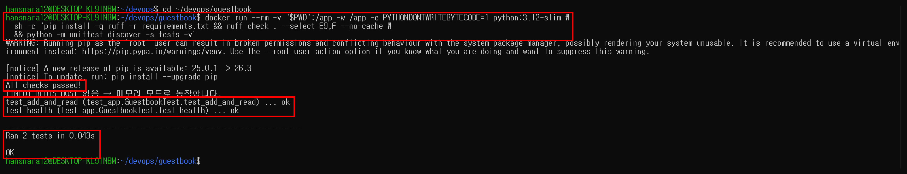

- `All checks passed!` → `test_add_and_read ... ok`, `test_health ... ok` → `Ran 2 tests` → `OK`
- `REDIS_HOST` 없이 돌려서 메모리 모드로 테스트된다. 워크플로의 `REDIS_HOST: ''`와 같은 조건

**2. PR → 머지 → 이미지 자동 생성** (40~46p)

PR #30 `CI 파이프라인 추가` → squash merge `f7aa95f`

| 실행 | 트리거 | 결과 | 한 일 |
|---|---|---|---|
| #1 | pull_request (feature/ci-setup) | ✓ 1m 11s | 린트 → 테스트 → 빌드 (푸시 안 함, 로그인 단계 건너뜀) |
| #2 | push (main, 머지) | ✓ 1m 15s | 린트 → 테스트 → 빌드 → **ghcr.io 푸시** |
| #3 | workflow_dispatch (수동) | ✓ 1m 4s | 같은 커밋이라 같은 태그로 다시 푸시 |

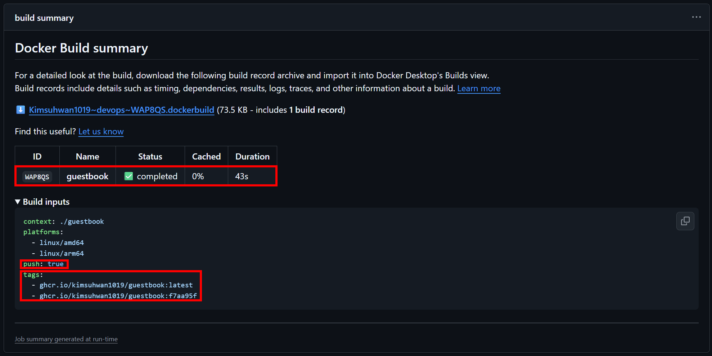

- main 실행의 Docker Build summary: `push: true`, 태그 `ghcr.io/kimsuhwan1019/guestbook:latest`, `:f7aa95f`, 플랫폼 amd64 + arm64
- 로그의 `IMAGE_NAME`은 `Kimsuhwan1019/guestbook`(대문자)인데 실제 태그는 소문자. metadata-action이 바꿔 준 것 (도커 이미지 이름은 소문자만 가능)
- 단계 중 `빌드 & 푸시`가 45s로 대부분. 린트·테스트는 각각 3s

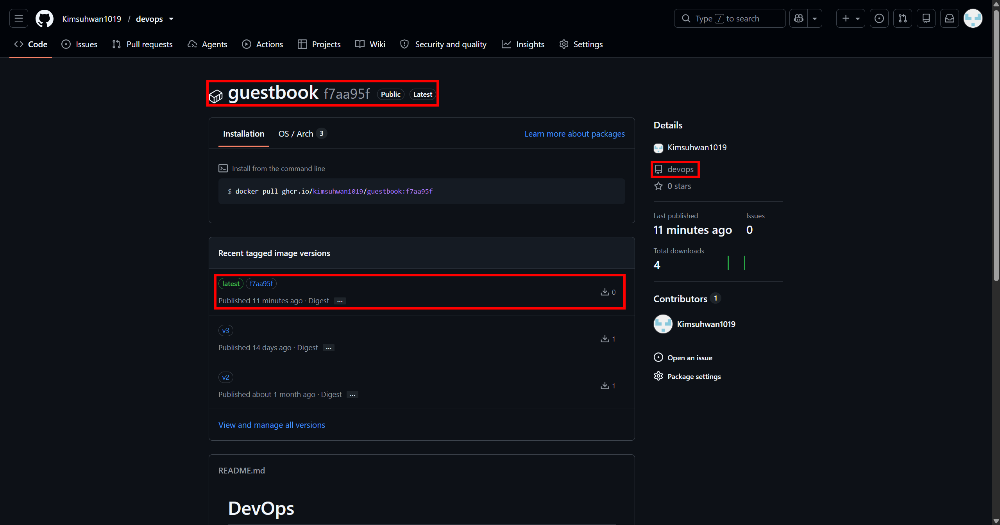

- Packages에 `latest` + `f7aa95f`가 새로 생겼고, 아래에 내가 손으로 올린 `v3`, `v2`가 남아 있다
- 패키지가 `devops` 저장소에 연결됐다. 6주차 CLI로 올릴 때는 연결이 없었다
- 내가 한 것은 git push, PR, 머지뿐. `docker build` / `docker push`는 치지 않았다

**3. CI 이미지를 쿠버네티스로** (47p)

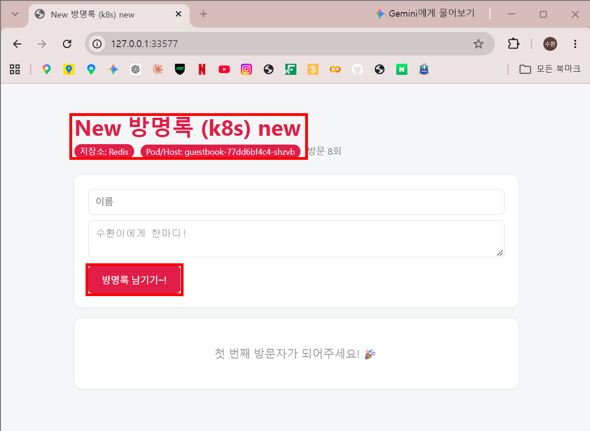

- `set image ... :f7aa95f` → `successfully rolled out` → 새 Pod `77dd6bf4c4-shzvb`, `sqj5z`
- 제목이 `New 방명록 (k8s) new`. 39p에서 템플릿에 넣은 `new`가 CI 이미지에 들어 있다
- 버튼도 `방명록 남기기~!`로 바뀌었다. 10주차에 템플릿을 고쳐 둔 내용까지 이번 이미지에 같이 들어간 것으로 보인다 (추측)
- 아직 `set image`는 손으로 친다. `deployment.yaml` 파일에는 `:v2`가 그대로라서 지금 `apply -f`하면 v2로 돌아간다 → 다음 주 CD(ArgoCD)가 풀 문제

**4. 일부러 망가뜨리기: 어느 단계가 잡는가** (50~59p)

같은 PR #31 안에서 커밋을 쌓으며 실험했다.

| 실행 | 넣은 문제 | compileall | 린트 | 테스트 | 결과 |
|---|---|---|---|---|---|
| #4 | `def broken(:` (문법 오류) | | ✗ 여기서 멈춤 | ⊘ | ✗ 13s |
| #5 | 마지막 줄 삭제 | | ✓ | ✓ | ✓ 57s |
| #6 | `print(APP_TITL)` (변수 오타) | **✓ 통과** | ✗ 여기서 멈춤 | ⊘ | ✗ 13s |
| #7 | revert + `/healthz` 응답 `200 → 500` | ✓ | **✓ 통과** | ✗ 여기서 멈춤 | ✗ 13s |
| #8 | revert | | ✓ | ✓ | ✓ 1m 9s |

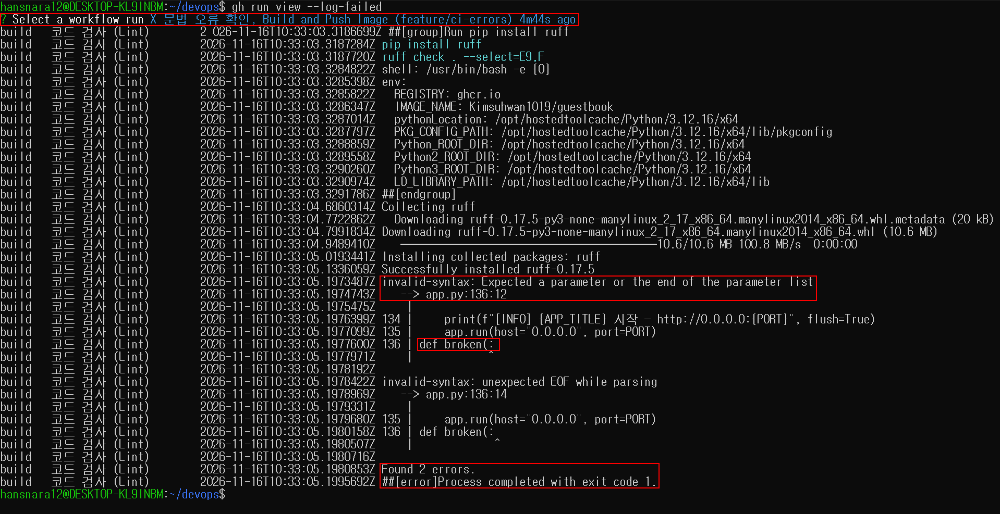

- 문법 오류: `invalid-syntax: Expected a parameter ...` → `app.py:136:12` → `Found 2 errors.` → `exit code 1` (교안과 줄 번호까지 같음)

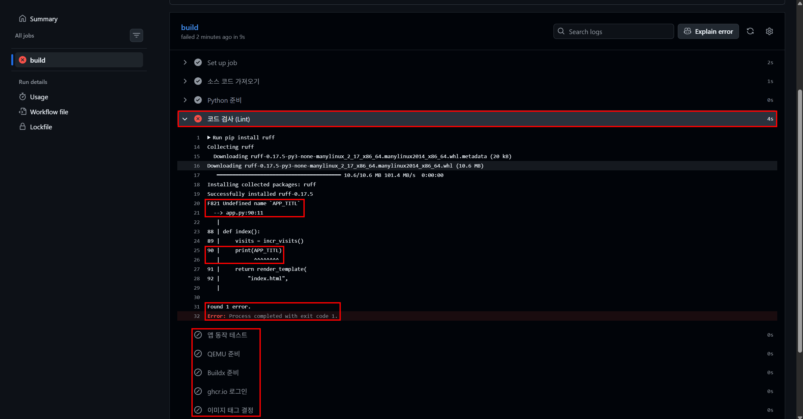

- 오타: 로컬 `compileall`은 `echo $?` → `0`(통과). 그런데 린트가 `F821 Undefined name APP_TITL` → `app.py:90:11`로 잡았다
- 그 아래 테스트·빌드·로그인·태그 단계가 전부 ⊘(건너뜀). 이대로 배포됐다면 `/`에 들어갈 때 HTTP 500

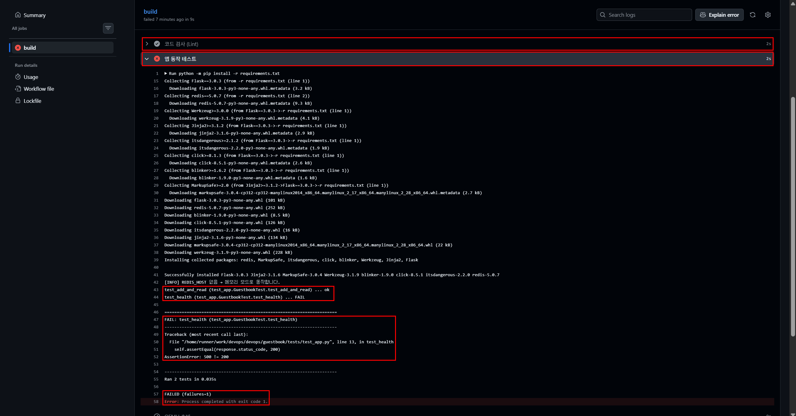

- 응답 코드 500: 문법도 맞고 변수 이름도 맞아서 **린트는 ✓**. 실제로 실행하는 테스트만 잡았다
- `test_add_and_read ... ok` / `test_health ... FAIL` → `AssertionError: 500 != 200` (test_app.py 13줄 `assertEqual(response.status_code, 200)`)
- 이대로 배포됐다면 liveness probe(`/healthz`)가 계속 실패해서 RESTARTS가 계속 올랐을 것 (11주차 실험과 같은 증상)

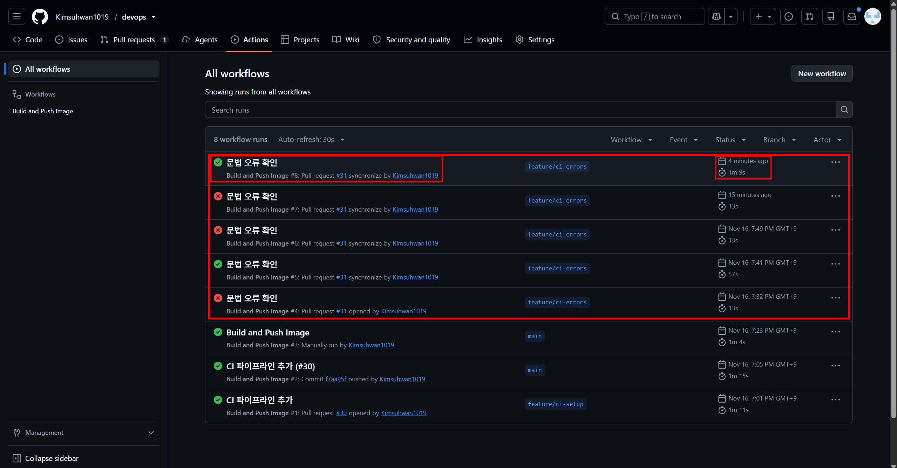

- 아래에서 위로 ✗ → ✓ → ✗ → ✗ → ✓. 실패한 실행은 모두 13s, 성공은 1분 남짓
- 시간만으로는 어느 단계에서 멈췄는지 알 수 없다(린트·테스트 둘 다 몇 초). 로그를 열어야 한다
- 이 PR은 이 상태에서도 머지 버튼이 살아 있었다. 브랜치 보호가 아직 `build`를 요구하지 않았기 때문 → 5번

**5. main에 문지기 두기** (60~66p)

4주차에 만든 Ruleset `main-protector`(PR 필수, 삭제 금지, force push 금지)에 `Require status checks to pass` → `build`를 추가했다.

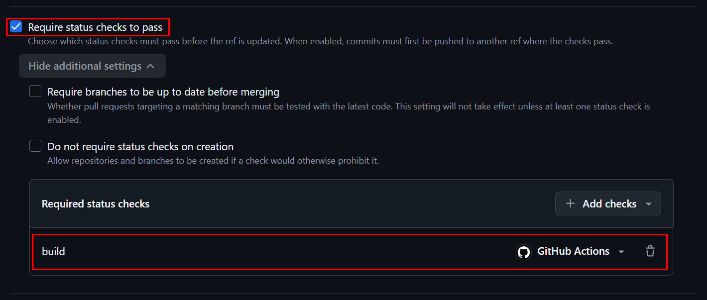

```
$ gh api ".../rules/branches/main" --jq '.[].type'
deletion
non_fast_forward
pull_request
required_status_checks        ← 이번에 추가
```

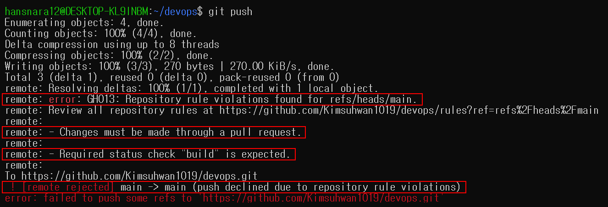

- main에 직접 push → `GH013` 거부. 사유가 두 줄이다: `Changes must be made through a pull request.` + **`Required status check "build" is expected.`**
- 4주차에는 PR 규칙만 걸려 있었고, 두 번째 줄이 이번 설정의 증거다. 정리는 `git reset --hard origin/main`

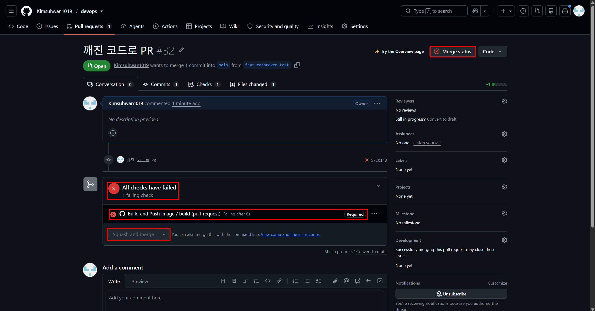

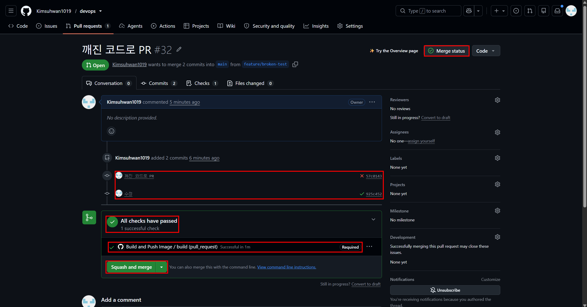

- PR #32에 `def broken2(:` → `All checks have failed`, 검사 옆에 **`Required`**, `Squash and merge`가 회색
- 마지막 줄을 지우고 push → `All checks have passed` → 초록 `Squash and merge`, Merge status도 ✓
- PR #31과 같은 빨간 X였지만 이번엔 머지가 막혔다. CI는 문제를 알려 주고, 막는 건 브랜치 보호 규칙이다

## 막혔던 부분

- **minikube를 다시 켜자 guestbook `0/1 Running`, 기다려도 안 풀림**: describe → `Readiness probe failed ... 503`(x25). `logs`를 `--tail`로 보니 probe 접속 기록에 묻혀 안 보여서 `grep -E "INFO|WARN"`으로 걸렀더니 `[WARN] Redis 연결 실패 (... Temporary failure in name resolution) → 메모리 모드`. guestbook이 클러스터 DNS보다 먼저 떠서 `redis`라는 이름을 못 찾았고, 이 앱은 시작할 때 한 번만 Redis 사용 여부를 정해서 계속 메모리 모드였다 → `rollout restart`로 새 Pod를 띄우자 `Redis 연결 성공`. 11번 교안 62p (2) "앱이 Redis보다 먼저 뜬 경우는 메모리 모드"를 실제로 겪었다
- **지난주 글과 방문 횟수가 사라짐**: Redis 컨테이너도 재시작됐는데 볼륨이 없어서 메모리에 있던 데이터가 같이 지워졌다. "Pod가 바뀌어도 글이 남는다"는 guestbook Pod 얘기였고, 저장소인 Redis가 재시작되면 다르다
- **39p `sed 's/v2/new/'`가 안 먹을 뻔함**: 내 템플릿에는 10주차 작업 때문에 `{{ title }} v3`가 남아 있었다 → 먼저 `grep`으로 확인하고 `v3 → new`로 바꿨다
- **22p 403 대비**: `guestbook` 패키지는 6주차에 CLI로 만들어서 저장소에 연결이 없었다 → 머지 전에 Package settings → Manage Actions access에 `devops`를 Write로 추가했더니 main 푸시가 한 번에 성공
- **`compileall`이 `__pycache__/`를 만듦**: `commit -am`은 추적 파일만 올려서 커밋엔 안 들어가지만 `rm -rf guestbook/__pycache__`로 정리
- **`gh pr view --web` → `xdg-open ... not found`**: WSL에 브라우저 연결 도구가 없음(4주차와 같음) → PR 주소를 Windows 브라우저에 직접 붙여넣음
- **PR 실행 제목이 커밋 메시지가 아님**: Actions 목록에서 PR 실행은 PR 제목(`문법 오류 확인`)으로 계속 표시된다. 몇 번째 커밋인지는 `#번호`와 `synchronize`로 구분
- **망가뜨리고 되돌리기만 한 PR을 머지**: main과 차이가 없어서 `Files changed 0`, 머지하면 빈 커밋이 들어간다(#31 `7d374bd`, #32 `8e50896`). `guestbook/**`가 안 바뀌어서 main push 워크플로도 돌지 않았다
- Annotations의 notice `The ubuntu-latest label will migrate to Ubuntu 26 ...`은 에러가 아니라 안내. 48p FAQ대로 갑자기 실패하면 `runs-on: ubuntu-24.04`로 고정해서 비교

---

<details>
<summary><b>개념 정리</b> (클릭해서 펼치기)</summary>

### CI / CD

| | 뜻 | 하는 일 |
|---|---|---|
| CI (Continuous Integration) | 지속적 통합 | 합칠 때마다 자동 검사·빌드 → 문제를 일찍 발견 |
| CD (Continuous Delivery) | 지속적 제공 | 언제든 배포 가능한 상태 유지 (운영 반영은 승인을 거칠 수 있음) |
| CD (Continuous Deployment) | 지속적 배포 | 검증 통과한 변경을 운영까지 자동 반영 |

- 파이프라인: 소스 가져오기 → 검사·테스트(실패 시 중단) → 이미지 빌드 → 레지스트리 푸시 → (CD) 쿠버네티스 배포
- CI가 머지를 자동으로 막아 주지는 않는다. 막는 건 브랜치 보호 규칙

### 워크플로 구조

| 개념 | 의미 |
|---|---|
| workflow | `.github/workflows/*.yml` 파일 하나 |
| trigger (`on`) | 언제 돌릴지: push, pull_request, schedule, workflow_dispatch(수동) |
| job | 작업 단위. 매번 깨끗한 새 서버에서 시작. 여러 job은 기본 병렬 (`needs`로 순서) |
| step | job 안의 한 단계. `uses`(남의 액션) 또는 `run`(내 명령) |
| runner (`runs-on`) | 실제로 도는 서버. `ubuntu-latest`는 깃허브가 빌려 줌 (공개 저장소 무료) |

- `uses: actions/checkout@v7` = 만든 곳 / 액션 이름 / 주 버전. 남의 코드가 내 저장소 권한으로 돈다 → 믿을 만한 것만
- `with:` 액션에 넘기는 설정 / `env:` 환경 변수 / `defaults.run.working-directory` `run:`만 그 폴더에서 (`uses:`에는 적용 안 됨)
- `permissions:` 필요한 권한만: `contents: read`(코드 읽기), `packages: write`(이미지 올리기)

### `${{ }}` 읽기

| 표현 | 뜻 |
|---|---|
| `github.actor` | 실행을 일으킨 사람 |
| `github.repository_owner` | 저장소 주인 |
| `github.event_name` | push, pull_request ... |
| `github.ref` | main push면 `refs/heads/main`, PR이면 `refs/pull/번호/merge` |
| `secrets.GITHUB_TOKEN` | 실행마다 깃허브가 새로 주는 임시 토큰 (끝나면 만료) → ghcr.io는 시크릿을 따로 안 만들어도 됨 |
| `steps.meta.outputs.tags` | `id: meta` 단계가 만든 태그 목록 |

- 변수 문법이 도구마다 다르다: 컴포즈 `${REDIS_PASSWORD}` / 쿠버네티스 `$(REDIS_PASSWORD)` / Actions `${{ secrets.… }}`
- PR에서는 이미지를 안 올린다: 로그인 `if:`와 빌드 `push:` 둘 다 `event_name != 'pull_request' && ref == 'refs/heads/main'`일 때만

### 종료 코드

- `run:` 줄을 셸처럼 실행하고 종료 코드만 본다. 0이면 초록, 아니면 빨간 X, 그 아래 단계는 전부 건너뜀
- 그래서 CI에 넣는 도구는 실패하면 0이 아닌 값을 돌려줘야 한다 (ruff, unittest, `curl -f`)
- 비용이 적고 빠른 검사를 앞에 둔다 (린트 → 테스트 → 빌드)

### 문법 검사 vs 린트 vs 테스트 (57p)

| | 문법 검사 | 린트 | 테스트 |
|---|---|---|---|
| 묻는 것 | 파이썬이 읽을 수 있나 | 읽히는데 버그 가능성은 | 의도대로 동작하나 |
| 코드 실행 | X | X | O |
| 오늘 예 | `def broken(:` | `print(APP_TITL)` | `/healthz`가 500 |
| 속도 | 아주 빠름 | 빠름 | 조금 느림 |

- `ruff --select=E9,F`: E9 문법 오류 / F 정의 안 된 이름, 안 쓰는 import 등
- 테스트를 통과했다고 버그가 없는 건 아니다. 테스트한 조건만 보장한다 → 기능을 추가하거나 고칠 때 테스트도 같이 늘린다

### 테스트 코드 (25~27p)

| 코드 | 의미 |
|---|---|
| `class ...(unittest.TestCase)` | 테스트 묶음 |
| `setUp` | 각 테스트 전에 실행. 메모리 방명록을 비워 테스트끼리 영향 없게 |
| `app.test_client()` | 서버를 띄우지 않고 요청을 보내는 가상 브라우저 |
| `def test...` | test로 시작하는 함수만 실행. 파일도 `test_`로 시작해야 찾음 |
| `assertEqual(실제, 기대)` | 다르면 실패 → 종료 코드 1 |
| `302` | 글 등록 후 첫 화면으로 돌려보내는 응답 |

- `test_app.py`는 "무엇이 올바른가"(파이썬), `build.yml`은 "언제·어디서·어떻게 검사하나"(YAML)

### 태깅 전략

- `latest`는 계속 덮어쓴다. 어제의 latest와 오늘의 latest는 다른 이미지 → 롤백할 때 어느 이미지였는지 알 수 없다
- `type=sha,prefix=,format=short` → 커밋 해시 7자리, `type=raw,value=latest,enable={{is_default_branch}}` → main일 때만 latest
- `rollout undo`가 되려면 옛 이미지가 레지스트리에 이름으로 남아 있어야 한다

### 브랜치 보호

| 방법 | 위치 |
|---|---|
| Ruleset | Settings → Rulesets → New branch ruleset → Include default branch → Require a pull request + Require status checks(`build`) |
| 클래식 | Settings → Branches → Add classic branch protection rule → `main`, PR 필수(approvals 끔), status checks(`build`), Do not allow bypassing |

- `build` 검사가 목록에 안 나오면 워크플로가 한 번도 안 돈 것 → PR을 먼저 올린다
- Require approvals를 켜면 혼자서는 머지 못 한다
- 이제 README만 고친 PR도 `build`를 통과해야 머지된다 (PR 트리거에는 `paths`가 없어서 항상 돈다)

### 로그 읽는 법 (58p)

- 맨 아래 `exit code 1`(결과) → 위로 올라가며 첫 오류 줄 → `파일:줄:칸`(위치) → 원인
- `Re-run jobs`는 코드를 안 바꾸고 다시 돌리기. 네트워크·권한 같은 일시적 실패일 때만

### FAQ (48p, 68p)

| 증상 | 원인 |
|---|---|
| Actions 탭에 아무것도 없음 | 파일이 `.github/workflows/`에 없거나 확장자가 다름 |
| Invalid workflow file | YAML 들여쓰기·키 이름 (`branch:` 아니고 `branches:`) |
| No module named 'app' | `working-directory` 빠짐 |
| NO TESTS RAN | 테스트 파일 위치·이름 (`test_`로 시작) |
| 빌드 & 푸시 denied / 403 | 패키지에 저장소 쓰기 권한 없음 → Manage Actions access |
| 머지했는데 이미지가 안 생김 | `paths`에 안 걸리는 변경이거나 아직 실행 중 |
| manifest unknown | 태그 오타 (7자리 커밋 해시) |
| 머지 버튼이 계속 회색 | 검사 실행 중, 또는 승인 요구가 켜져 있음 |

### 지난주 내용 기말 대비 (11번 교안, 이번 주 수업에서 강조)

- **45p RESTARTS 증가**: 계속 재시작 중. 원인은 liveness 실패, 앱 오류, OOM 등 → `describe` Events. 숫자 자체보다 **늘어나는지**가 핵심 (minikube 재시작으로 생긴 1은 고장이 아님)
- **48p 파이프 `|`**: 왼쪽 명령의 출력을 오른쪽 명령의 입력으로 넘긴다. "또는(or)"이 아니다. `describe pod ... | tail -2` = describe 결과의 마지막 두 줄(Events)만. 단, `grep -E "A|B"`처럼 따옴표 안의 `|`는 정규식의 "또는"
- **61p 오류 찾기**: `DB_PORT: 5432` 따옴표 없음 / `configMapRef: shop-conf` ≠ `shop-config` / readiness `port: 80` ≠ 앱 8080
- **62p**: 0/1 Running + 503 → 접속 실패, 재시작 안 함 / 의심: 비밀번호 불일치, 이름 오타, 앱이 Redis보다 먼저 떠 메모리 모드 / 다음 명령 `kubectl logs -l app=board --tail=50; kubectl get svc`

### 다음 주: CD (76p)

- 지금은 CI가 이미지를 올려도 `kubectl set image`는 사람이 친다
- ArgoCD: Git에 적힌 배포 설정과 클러스터 상태를 비교해 맞춘다. 새 이미지가 올라왔다고 자동 배포되는 게 아니라, Git의 이미지 태그를 바꾸는 과정이 따로 필요하다
- GitOps: Git에 기록된 상태가 운영의 기준 (SSOT)

</details>
