# 13주차 - GitOps (Argo CD) · 배포 전략 · 모니터링

Argo CD를 minikube에 설치하고 방명록(guestbook)을 Git 저장소와 동기화했다. 이번 주에는 `kubectl`로 배포하지 않았다. **PR을 머지하는 것만으로** 스케일, 롤백, 삭제, 새 이미지 배포까지 진행했다.
수업 후에는 `kubectl top`, Prometheus·Grafana로 부하를 걸어 보고 CPU 변화를 관찰했다.

```
코드 PR ─▶ CI(GitHub Actions) ─▶ ghcr.io/…/guestbook:522c239
                                        │
          image 태그 PR (deployment.yaml) ▼
Git(main) ◀──감시── Argo CD(클러스터 안) ──적용──▶ minikube ──▶ kubectl top / Grafana
```

## 오늘 배운 내용
- GitOps = "Git이 곧 진실". 클러스터는 언제나 Git에 적힌 상태와 같아야 한다
- Push 방식(CI가 클러스터에 배포)과 Pull 방식(클러스터 안의 Argo CD가 Git을 가져와 적용)의 차이
- `automated` / `prune` / `selfHeal`: 자동 반영, Git에서 지우면 삭제, 손으로 바꾸면 되돌림
- 되돌리기는 `kubectl rollout undo`가 아니라 `git revert` → PR → 머지
- 배포 전략 Recreate / Rolling / Blue·Green / Canary와 A/B 테스트의 차이
- 메트릭 / 로그 / 트레이스, Prometheus(수집, Pull) · Grafana(시각화) · Alertmanager(알림)
- 상세는 맨 아래 개념 정리에

## 새로 배운 명령어
```bash
# --- Argo CD 설치·접속 ---
kubectl create namespace argocd                                    # Argo CD 전용 네임스페이스
kubectl apply -n argocd --server-side --force-conflicts -f <install.yaml URL>   # 수십 개 오브젝트를 서버 쪽에서 한 번에 적용
kubectl port-forward svc/argocd-server -n argocd 8443:443          # https://localhost:8443 으로 화면 연결
kubectl -n argocd get secret argocd-initial-admin-secret -o jsonpath="{.data.password}" | base64 -d   # 첫 로그인 비밀번호

# --- 애플리케이션 등록·확인 ---
kubectl apply -f argocd-application.yaml                           # "이 Git을 이 클러스터에 맞추시오" 등록
kubectl get application -n argocd                                  # SYNC STATUS / HEALTH STATUS 확인
kubectl delete -f argocd-application.yaml                          # 등록 해제 (배포된 리소스는 남음)

# --- GitOps 작업 ---
git revert "$SCALE_COMMIT" --no-edit                               # 커밋을 지우지 않고 되돌리는 커밋 추가
git rev-parse --short HEAD                                         # 머지 커밋 7자리 = CI가 만든 이미지 태그
gh pr checks --watch                                               # 필수 검사(build)가 끝날 때까지 대기

# --- 모니터링 (수업 후) ---
minikube addons enable metrics-server                              # kubectl top 에 필요한 메트릭 수집기
kubectl top pods / kubectl top nodes                               # Pod·노드의 CPU(m)·메모리(Mi)
helm install monitoring prometheus-community/kube-prometheus-stack -n monitoring --create-namespace   # Prometheus+Grafana 한 번에
kubectl run load --image=busybox --restart=Never -- sh -c "while true; do wget -q -O /dev/null http://guestbook/; done"   # 부하
kubectl delete pod load                                            # 부하 정리 (안 지우면 계속 돎)
kubectl logs -l app=guestbook -f --prefix                          # 여러 Pod 로그를 Pod 이름과 함께 실시간으로
```

## 실행 방법
```bash
minikube start --driver=docker
kubectl apply -f guestbook/k8s                       # 처음 한 번 (이후 배포는 Argo CD가 담당)
# Argo CD 설치 후
kubectl apply -f argocd-application.yaml             # repoURL은 본인 저장소, 저장소는 public
kubectl get application -n argocd                    # guestbook  Synced  Healthy
# 이후 변경은 guestbook/k8s/ 파일을 고치는 PR → main 머지 → 약 3분 안에 자동 반영
# 종료: kubectl delete -f argocd-application.yaml → minikube stop
```

## 파일 구성
```
devops/
├── argocd-application.yaml      # Argo CD Application 정의 (저장소 루트, guestbook/k8s/ 밖)
├── guestbook/
│   ├── templates/index.html     # <h1> 제목 new → CI/CD
│   └── k8s/deployment.yaml      # image :v2 → :522c239 (replicas 2 → 4 → 2)
└── week13/
    ├── README.md
    └── images/                  # 실행 결과 캡처 15장
```

## 실행 결과
| PR | 커밋 | 한 일 | 클러스터에서 일어난 일 |
|---|---|---|---|
| #35 | `9de5935` | Application 등록 기록 | 변화 없음 (기록만) |
| #36 | `0be4d22` | replicas 2 → 4 | Pod 4개 |
| #37 | `4d13a0c` | #36 revert | Pod 2개 |
| #38 / #39 | `47cb1d5` / `9fcd3f3` | hello ConfigMap 추가 / 삭제 | 생성 / 삭제 (prune) |
| #40 | `522c239` | 제목 CI/CD | CI가 이미지 `:522c239` 게시 |
| #41 | `5edd3d9` | image 태그 :v2 → :522c239 | 롤링 업데이트 |

**Argo CD 등록**: Healthy · Synced · Auto sync

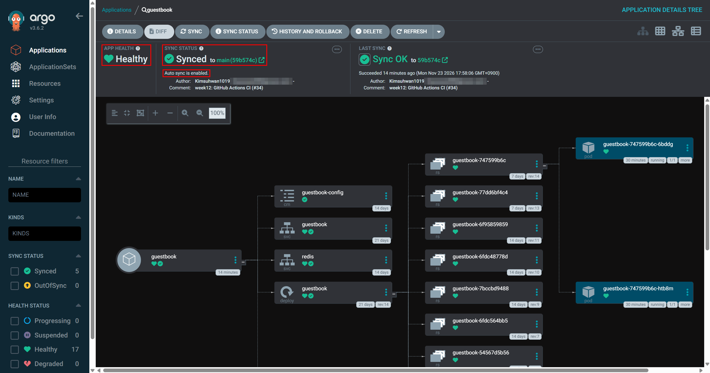

**Git만 바꿔서 replicas 4**: `kubectl scale`을 치지 않았는데 Pod가 2개 늘었다

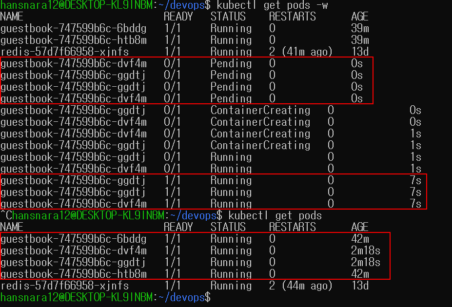

**손으로 10개로 바꾸면**: selfHeal이 **6초 만에** 늘어난 6개를 Terminating으로 돌리고, 다시 4개 · Synced

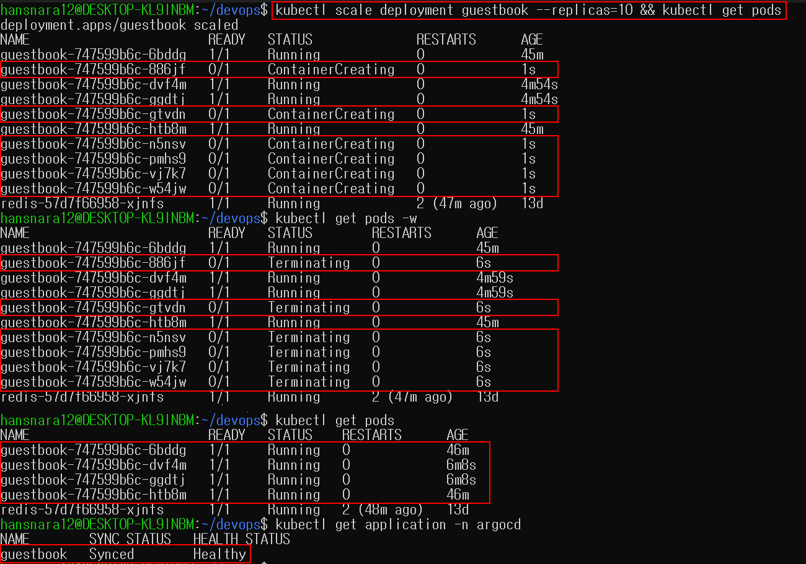

**git revert로 롤백**: Pod 2개로 돌아오고, replicas 4 커밋(#36)과 되돌린 커밋(#37)이 둘 다 기록에 남았다

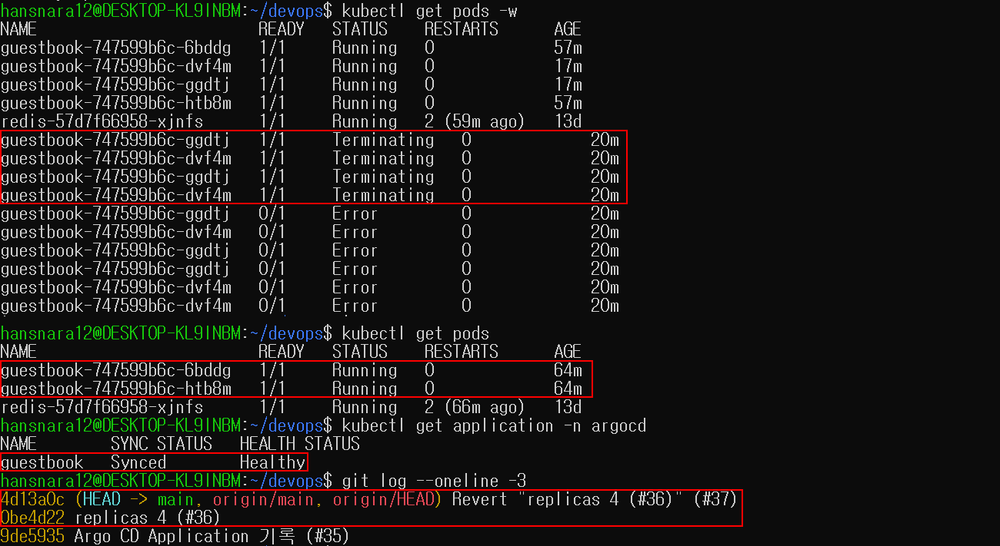

**prune**: Git에 hello.yaml을 추가하자 ConfigMap이 생기고, `git rm` 후에는 클러스터에서도 사라졌다

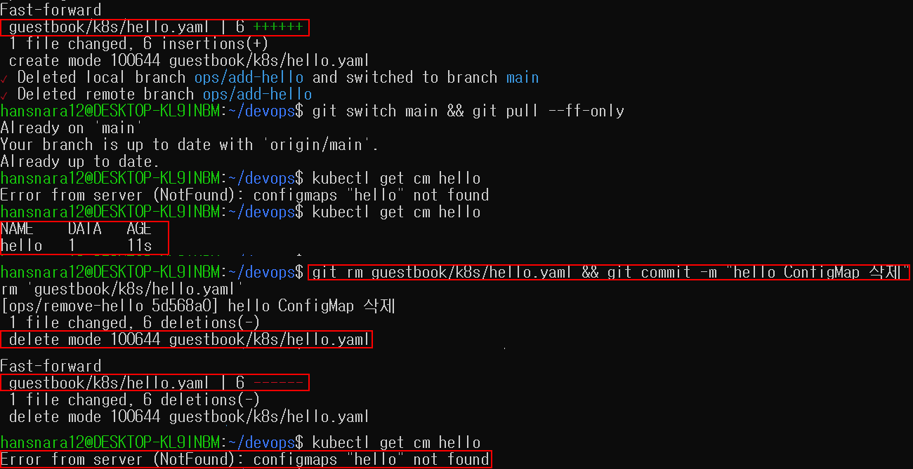

**이미지 배포 ① 코드 PR**: 검사 전에 머지하면 보호 규칙이 막는다 → 검사 통과 후 머지 → main CI ✓ → 태그 `522c239`

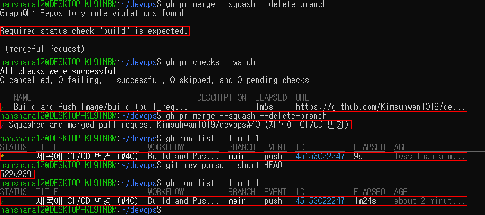

**이미지 배포 ② 태그 PR**: 사람이 바꾼 건 `image:` 한 줄뿐

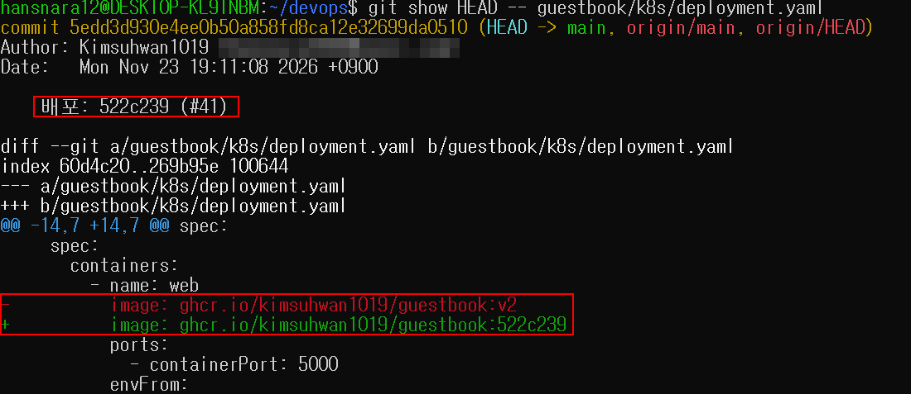

**이미지 배포 ③ 롤링 업데이트**: 새 Pod가 1/1이 된 뒤에 옛 Pod가 하나씩 내려갔다

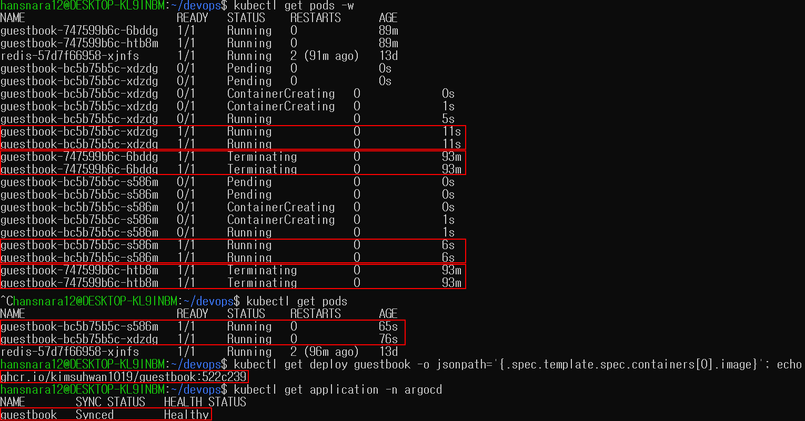

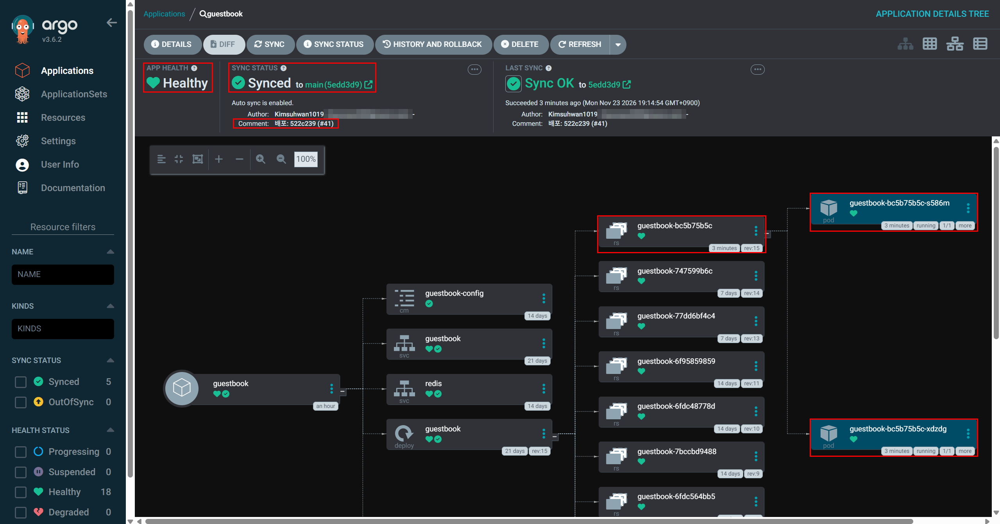

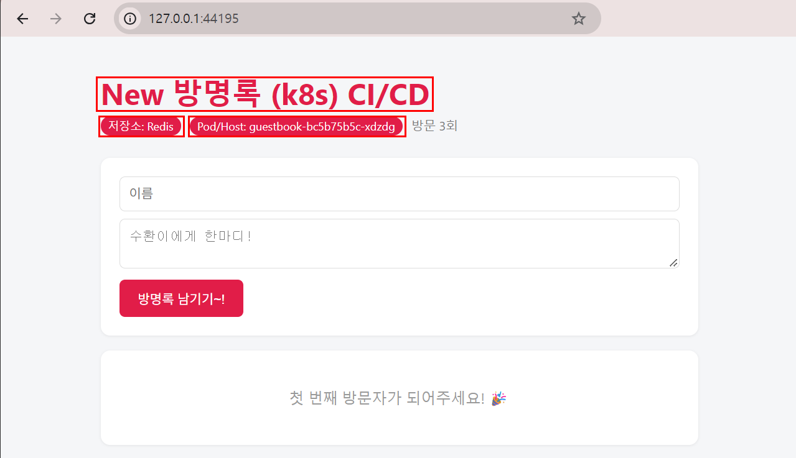

**`kubectl top`** (수업 후 진행): guestbook CPU 1m / limits 500m, 메모리 27~36Mi / limits 128Mi

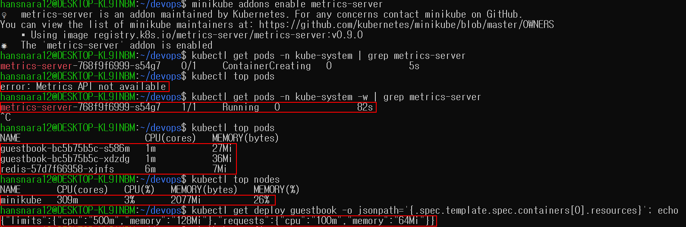

**Grafana로 부하 관찰** (수업 후 진행): CPU가 requests(0.1)를 넘어 0.216, Requests 216% · Limits 43.2% · Throttling 0%

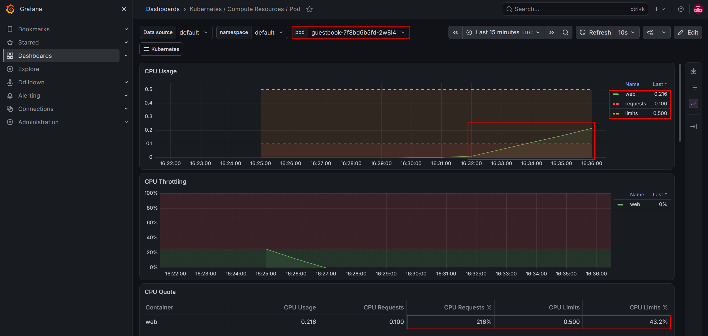

**부하 걸기와 정리** (수업 후 진행): guestbook 1m → 약 245m, `delete pod load` 후 다시 1m

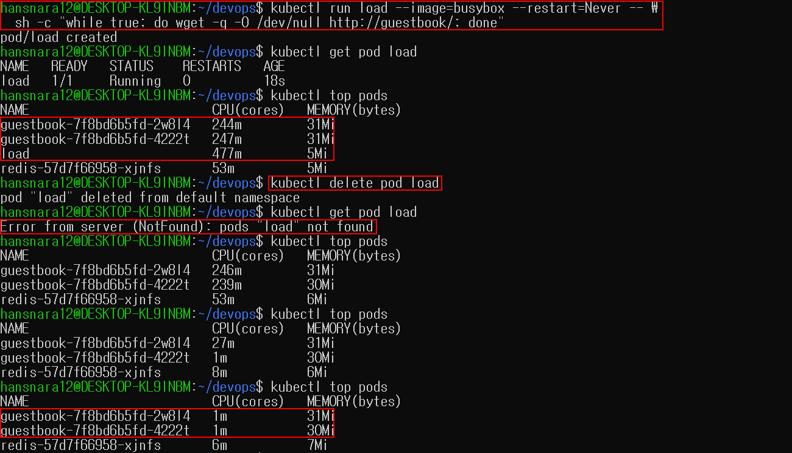

**로그** (수업 후 진행): Pod 이름을 붙여 보기, error 없음, 부하 요청 `GET /` 56,809줄

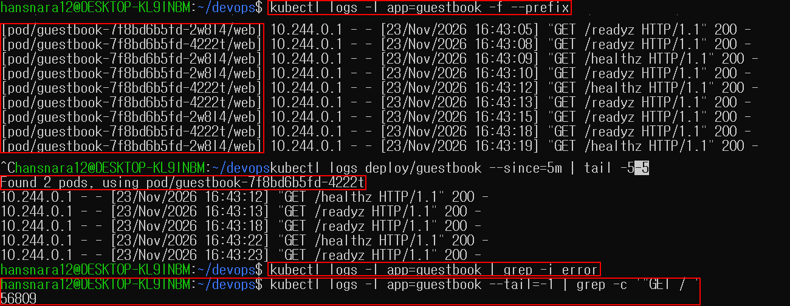

**정리**: Application 등록을 해제해도 guestbook과 redis는 남는다

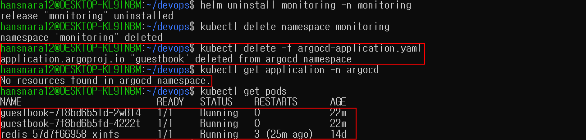

## 막혔던 부분
- **Docker Desktop이 꺼져 있어서 `minikube start` 실패** (`PROVIDER_DOCKER_VERSION_EXIT_1`) → Docker Desktop 실행 후 `docker version`으로 연결 확인
- **minikube 재시작 후 guestbook `0/1`** (클러스터 DNS보다 앱이 먼저 떠 Redis를 못 찾음) → `kubectl rollout restart deployment guestbook`
- **교안대로 `gh pr create --fill && gh pr merge`를 바로 이어서 치면 거부됨**: 12주차에 건 보호 규칙 때문에 `Required status check "build" is expected.` → 중간에 `gh pr checks --watch`를 넣었다. PR을 만든 직후에는 `no checks reported`가 나올 수 있어 몇 초 뒤 다시 실행
- **태그 PR은 main CI가 ✓가 된 뒤에**: `*`(진행 중)일 때 태그를 바꾸면 아직 없는 이미지를 받으려다 ImagePullBackOff → Synced인데 Degraded (68p 상황)
- **지워지는 Pod가 30초 뒤 `Error`로 표시됨**: SIGTERM에 바로 종료하지 않아 30초 대기 후 강제 종료된 것으로 보인다(추측). 서비스에는 영향 없음
- **snap으로 설치한 helm이 실행되지 않음** (`missing file /snap/helm/.../snap.yaml`, WSL에서 mount 실패) → snap helm 제거 후 공식 설치 스크립트(`get-helm-3`)로 helm v3.22.1 설치
- **16GB 노트북에서 Argo CD + kube-prometheus-stack 동시 실행 → 메모리 83%, 디스크 100%, API 서버 무응답** (`TLS handshake timeout`) → 재부팅, GitOps 실습이 끝난 Argo CD를 replicas 0으로 줄이고 진행, 모니터링은 실습 후 바로 `helm uninstall`
- **Grafana 그래프가 1~2분 늦게 따라온다**: `load`를 지운 직후에도 `top pods`가 246m → 27m → 1m 순으로 내려갔다

---

<details>
<summary><b>개념 정리</b> (클릭해서 펼치기)</summary>

### GitOps와 Push / Pull
| | Push (CI가 직접 배포) | Pull (GitOps, Argo CD) |
|---|---|---|
| 클러스터 수정 주체 | 바깥의 CI 서버 | 클러스터 안의 Argo CD |
| 필요한 권한 | CI에 클러스터 접속 권한 | 바깥에 줄 권한 없음 |
| 방화벽 뒤 클러스터 | 접속 어려움 | 안에서 밖(GitHub)으로 나감 |
| 배포 기록 | 파이프라인 로그를 따로 관리 | Git 히스토리 |
| 누가 손 수정 | 별도 감지·복구 체계 필요 | 감지하고 되돌림 (selfHeal) |
| 되돌리기 | 이전 파이프라인 다시 실행 | `git revert` |

- 선언형의 완성: Git = 원하는 상태, 클러스터 = 현재 상태, Argo CD = 둘을 계속 비교하고 맞추는 감시자 (관찰 → 비교 → 조치)
- **drift**: 클러스터가 Git의 선언에서 벗어난 상태. Argo CD는 **OutOfSync로 표시하고, selfHeal이 켜져 있으면 Git 값으로 되돌려 다시 Synced로 만든다**

### Application 해석
| 줄 | 의미 |
|---|---|
| `kind: Application`, `namespace: argocd` | "이 Git을 이 클러스터에 맞추시오", argocd 네임스페이스에 둠 |
| `repoURL`, `targetRevision: main`, `path: guestbook/k8s` | 지켜볼 저장소·브랜치·디렉터리 |
| `destination.server`, `destination.namespace` | 배포 대상 클러스터 API 주소, 네임스페이스 |
| `automated` | Git이 바뀌면 자동 적용 (없으면 Sync 버튼) |
| `prune: true` | Git에서 지운 리소스를 클러스터에서도 삭제 |
| `selfHeal: true` | 손으로 바꾼 것을 Git 기준으로 되돌림 |

- Application 파일은 저장소 루트에. `guestbook/k8s/` 안에 두면 Argo CD가 자기 설정까지 관리하게 된다
- Git 변경은 약 3분 간격으로 확인 (급하면 Refresh / Sync), 클러스터 변경은 수 초 안에 감지

### Argo CD 화면 읽기
| 값 | 의미 |
|---|---|
| Healthy / Progressing / Degraded / Missing | 정상 / 바뀌는 중 / 문제(ImagePullBackOff 등) / Git에는 있지만 클러스터에 없음 |
| Synced / OutOfSync | 클러스터 = Git / 클러스터 ≠ Git |

- **Synced + Degraded**: Git대로 정확히 배포했지만 Git 내용이 틀림 (예: 없는 이미지 태그)

### rollout undo vs git revert
| | `kubectl rollout undo` | `git revert` + Argo CD |
|---|---|---|
| 되돌리는 곳 | 클러스터 직접 | Git (클러스터에 자동 반영) |
| 기록 | 클러스터 안 revision 번호 | 커밋 (누가, 언제, 왜) |
| 리뷰 | 없음 | PR로 가능 |
| selfHeal 켜짐 | Git 상태로 다시 돌아감 | 그대로 유지 |

### CI → CD 연결
1. CI가 새 이미지를 GHCR에 게시 (커밋 해시 태그)
2. `deployment.yaml`의 `image:`를 그 태그로 바꾸는 PR을 머지 ← 이번 수업은 사람이 직접
3. Argo CD가 바뀐 Git을 감지해 배포
- 이미지를 푸시하는 것만으로 Git의 `image:`는 바뀌지 않는다 → Argo CD가 보기엔 달라진 게 없음
- [심화, 설명만] CI가 태그 PR까지 만들면 사람은 머지(= 배포 승인)만 한다. Actions의 PR 생성 허용, `contents: write`·`pull-requests: write` 권한, paths에 `'!guestbook/k8s/**'` 추가 필요. Argo CD Image Updater도 있음

### 배포 전략
| 전략 | 비유 | 방법 | 감당할 것 |
|---|---|---|---|
| Recreate | 가게 문 닫고 인테리어 | 옛 Pod 전부 내리고 → 새 Pod | 서비스 중단 |
| RollingUpdate (기본값) | 직원 한 명씩 교대 | 새 Pod 늘리며 옛 Pod 줄임 | 잠깐 두 버전 섞임 |
| Blue/Green | 새 매장 차리고 간판만 교체 | v2 다 띄우고 Service selector 한 줄로 전환 | 두 환경 유지 자원 |
| Canary | 손님 10%만 새 메뉴 | 일부에게만 v2 → 지켜보고 늘림 | 지켜볼 사람(모니터링) |

- A/B 테스트는 배포 전략이 아니라 배포 위의 실험. Canary는 "새 버전이 안전한가?", A/B는 "어느 쪽이 더 좋은가?"(클릭·가입·매출, 며칠~몇 주)
- 상황별: DB 구조 변경 → Recreate / 평소 작은 배포 → Rolling / 즉시 통째로 되돌려야 함 → Blue/Green / 큰 변경 일부 먼저 → Canary / 어떤 색이 매력적? → A/B

### 모니터링
| 종류 | 무엇 | 도구 | 예 |
|---|---|---|---|
| 메트릭 | 시간에 따른 숫자 | Prometheus | CPU 80%, 요청 1200/초 |
| 로그 | 텍스트 기록 | Loki, ELK | ERROR: DB 연결 실패 |
| 트레이스 | 요청의 여정 | Jaeger | 이 요청이 3초 걸린 이유 |

- 골든 시그널: 지연(latency), 트래픽(traffic), 에러(errors), 포화(saturation)
- Prometheus는 **Pull**: 앱의 `/metrics`를 주기적으로 가져간다 (probe와 같은 원리). 형식은 `이름{라벨} 값`
- `kubectl top`: `1m` = CPU 1개의 0.1%, `28Mi` ≈ 30MB. 메모리 limit 초과 → OOM kill, CPU limit 초과 → Throttling(느려짐)
- 로그는 Pod가 지워지면 같이 사라진다 → Loki, ELK로 모아 둔다. `-l`만 쓰면 Pod당 마지막 10줄
- 알림은 사람이 무언가 해야 할 때만 (예: 메모리 limit 90%가 5분 넘게, Pod가 10분 동안 5번 이상 재시작)

</details>
